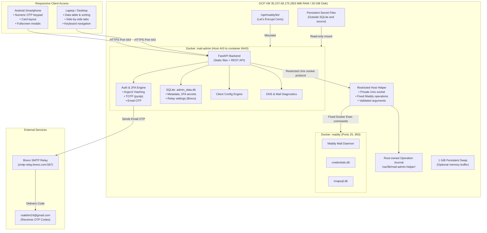

# Architecture and resource boundaries

## Architecture & Resource Footprint

### Resource Breakdown

* **Runtime memory**: Measure idle usage and peak usage during password hashing, concurrent login attempts, diagnostics, and mailbox operations. Include the helper and transient Docker processes. Choose the container memory limit and hashing concurrency from those measurements while preserving capacity for Maddy and the host.
* **Build memory**: Build the complete runtime image locally or in approved CI for **Linux/amd64**. Do not run frontend or image builds on the mail VM.
* **Disk**: Measure the runtime image, retained rollback image, data, logs, and backups; the earlier 200 MB total estimate is not an acceptance criterion.
* **Swap**: If provisioned, use a **1 GiB** swapfile with restrictive permissions and a validated persistent `/etc/fstab` entry. Swap does not guarantee stability or replace load testing and memory limits.

---
