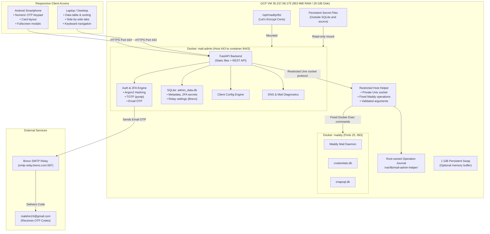

# Implementation Plan: Self-Hosted Mail Admin Dashboard (React + Material UI)

Build, secure, and deploy a self-hosted **Mail Admin Dashboard** for `rsalehin24.me` on the existing GCP mail server (`35.237.68.175`, accessible with `ssh deployer@35.237.68.175` or [mail.sh](/Users/rsalehin24/mail.sh)).

The system pairs a **FastAPI backend** with a **minimalist React + Material UI (MUI)** frontend compiled to static assets. It is fully responsive across **Android phones, laptops, and desktops**. Build the Linux runtime image outside the mail VM and measure resource usage before deployment; the earlier 50 MB runtime estimate is not verified.

---

## Verified Server Baseline — October 21–22, 2026

These facts were checked over SSH and, where noted, from an external client. The latest SSH recheck was **October 22, 2026 at 02:30 Asia/Dhaka (October 21 at 20:30 UTC)**. Recheck them before deployment. The older `maddy-mail-server-docs.txt` is not the deployment source of truth.

| Item | Verified state |
| :--- | :--- |
| Host | Ubuntu 26.04 LTS, Linux/amd64, `35.237.68.175` |
| Maddy | Running version **0.9.5**, using the mutable `foxcpp/maddy:latest` image tag |
| Configuration and storage | `/opt/maddy/config/maddy.conf`; SQLite `credentials.db` and `imapsql.db` under `/opt/maddy/data` |
| Existing data permissions | Follow-up review confirmed `nobody` can read both Maddy databases and all **143 stored message files**; data directories are traversable and files are `0644`. Restrict access before deployment. |
| Account inventory | **8 credential accounts and 8 matching IMAP accounts**; local parts: `cloud`, `demo_user.library`, `dev_01`, `dev_02`, `library`, `mail`, `reyan`, and `salehin`, all under `rsalehin24.me` |
| Memory and disk | **952.7 MiB RAM total**, **551.7 MiB available at the latest SSH check**, and **22.4 GiB disk free**; no active swap. Available memory varies; this snapshot is not a runtime budget. |
| Published services | TCP **25 and 993** reachable externally; no listener on **443**; Maddy submission ports are not published |
| Certificates | `/opt/maddy/tls/fullchain.pem` and `privkey.pem`, mounted into Maddy at `/data/tls`; externally verified IMAPS certificate valid through **December 26, 2026** |
| DNS | `mail.rsalehin24.me` resolves to the server; public domain MX records point to Cloudflare Email Routing |
| Renewal | `/opt/maddy/renew-cert.sh` restarts only Maddy; `maddy-cert-renew.timer` checks monthly on day 1 at 03:00 UTC, with a 32-day threshold |
| Brevo | Connection to `smtp-relay.brevo.com:587` and verified STARTTLS succeed; SMTP credentials, sender authorization, and mail delivery remain untested |
| Dashboard | `/opt/mail-admin` and the dashboard container do not exist yet; application performance and behavior remain unverified |
| Boot and clock | Docker is enabled at boot; system clock synchronized with NTP active. The helper is not installed yet. |
| Host maintenance and tools | A host restart is required; include it in the agreed reboot window. Docker Compose **5.1.4** and util-linux `flock` **2.41.3** are installed. No host updates or reboot were performed during review. |
| Process umask | Both the Maddy daemon and a fresh `docker exec` process use `0022`. A read-only probe confirmed that setting the invoking host process to `0077` does **not** change the container exec process's umask. |
| Operational recipient | The configuration rewrites bare `postmaster` to `postmaster@rsalehin24.me`, which is absent from both account inventories. Delivery to that operational address remains unverified; resolve it before any direct-MX cutover. |

The running Maddy version and renewal script match this plan's original assumptions. Review the [Maddy 0.9.6 security release](https://github.com/foxcpp/maddy/releases/tag/v0.9.6) before deployment, assess applicability, and pin a tested image digest. Any upgrade needs a consistent backup, compatibility checks, and a rollback procedure; do not upgrade implicitly while deploying the dashboard.

The baseline Maddy local image ID is `sha256:de42151adff6388edb5e4ee88f60334fa1ab85e309485193ecb1c2db20203315`. The legacy renewal script SHA-256 is `638dfd7338d3b7d7c518089cfe631847568f4e9862ec9c02c8415c5352acdfc2`; it still copies the flat TLS files, restarts Maddy, and uses no `flock`. Its timer is enabled, its oneshot service was inactive at the check, and its next scheduled run was November 1 at 03:00 UTC. An inactive snapshot does not replace the required drain immediately before maintenance.

---

## Deployment Decisions & Boundaries

> [!IMPORTANT]
> **Admin Email & Authentication**: Strictly locked to `rsalehin24@gmail.com`. The email identifies the admin but does not prove ownership. Provision a private bootstrap token through SSH, require it for all setup API access, and complete setup only after verifying the admin's TOTP code.

> [!NOTE]
> **Required Decisions**: Confirm whether to retain Cloudflare Email Routing or make Maddy the domain's primary MX. Preserve existing routing until an explicit cutover decision. Confirm the tested Maddy version, backup destination, independent alert channel, and any maintenance window before upgrading or changing production mail delivery.

This document authorizes no deployment by itself. Implementation must preserve existing accounts and messages, and treat DNS cutover, Maddy upgrades, and permanent mailbox deletion as explicit operational actions.

### Required Deployment Record

Prepare one non-secret deployment record with the release artifacts, then install it root-owned at `/etc/mail-admin/deployment.json` during host provisioning. Reuse this record for the helper's expected image/mount configuration and host deployment procedures. Store credentials and key material separately in their specified protected locations. Every required configuration value and pre-production fixture result must be present before entering maintenance. Add production evidence at the phase that produces it; the next dependent phase cannot proceed until it passes. A missing preflight value stops rollout before maintenance.

| Required record | Concrete completion condition |
| :--- | :--- |
| Release artifacts | Tested Linux/amd64 image identity, pinned dependencies, helper protocol/dashboard schema versions, launcher/renewal/unit configuration identities, exact project check commands/results, and a compatible rollback set. The isolated suite and dashboard recovery fixtures pass before production changes. |
| Maddy and routing | Record the selected pinned Maddy identity and security-release assessment. Preserve the verified baseline image and Cloudflare routing unless a separate upgrade or MX cutover is explicitly selected and tested. Record reviewed recipient dependencies and their configuration identities. |
| Backup and recovery | Record the actual off-VM destination, tested backup/encryption mechanism, separately recoverable decryption-key reference, cadence, finite retention, recovery-point/time objectives, and maximum deletion-backup age. Test the mechanism with fixtures before maintenance; the baseline backup phase must produce a verified production archive and timed isolated restore before hardening. |
| Independent notifications | Record the provider/channel, operator recipient, root-owned credential reference, external 993/443 monitoring, and delivered failure/recovery test evidence independent of dashboard availability. |
| Identities and resources | Record available service UID/GID, required group access, measured memory/tmpfs/hash/HTTP concurrency budgets, bounded lock/operation waits, free-space/inode thresholds, and whether swap is selected. Documentation-validation fixture values are never production defaults. |
| Maintenance | Record the approved rollout/reboot window, recurring backup/renewal interruption allowance, timer/container state before entry, backup staging space, restart-required state, checkpoints, and the operator's abort/rollback procedure. Include the host reboot and client interruption in that window. |

These are explicit release inputs and pass/fail gates. Their destinations, credentials, resource measurements, and maintenance approval cannot be inferred from SSH access. Keep deletion disabled until its backup and dependency checks pass, and Email OTP disabled until the current relay configuration has confirmed delivery. Retaining Cloudflare requires no MX change.

---

## Architecture & Resource Footprint



### Resource Breakdown

* **Runtime memory**: Measure idle usage and peak usage during password hashing, concurrent login attempts, diagnostics, and mailbox operations. Include the helper and transient Docker processes. Choose the container memory limit and hashing concurrency from those measurements while preserving capacity for Maddy and the host.
* **Build memory**: Build the complete runtime image locally or in approved CI for **Linux/amd64**. Do not run frontend or image builds on the mail VM.
* **Disk**: Measure the runtime image, retained rollback image, data, logs, and backups; the earlier 200 MB total estimate is not an acceptance criterion.
* **Swap**: If provisioned, use a **1 GiB** swapfile with restrictive permissions and a validated persistent `/etc/fstab` entry. Swap does not guarantee stability or replace load testing and memory limits.

---

## Detailed Gap Analysis & Solutions

| # | Potential Gap | Root Cause | Built-in Solution |
| :--- | :--- | :--- | :--- |
| **1** | **Certificate expiry, stale activation, or interrupted pair installation** | Monthly checks can miss failures; renewal updates only Maddy; replacing two files separately can leave a mismatched pair after interruption | Check daily, publish complete immutable certificate generations, pin each consumer to one generation, and recover pending activation from durable state. |
| **2** | **Memory exhaustion** | On-VM builds and concurrent password hashing can exceed available RAM | Build outside the VM, benchmark peak runtime usage, bound hashing concurrency, and make any swap persistent. |
| **3** | **Setup takeover / 2FA lockout** | A fixed email does not authenticate the first visitor; Email OTP depends on working Brevo credentials | Require a private bootstrap token, verify TOTP before initialization, and issue hash-stored recovery codes. Enable Email OTP after an authenticated delivery test. |
| **4** | **Missing, inconsistent, or partly deleted accounts** | Credentials, IMAP storage, metadata, and message files are separate; deletion can remove files before the database commits | Reconcile inventories and journaled outcomes, preserve functional accounts, and require operator reconciliation for failed storage deletion without assuming remaining messages are intact. |
| **5** | **Confusion Over Dual Passwords** | IMAP uses Maddy password; SMTP uses Brevo master key | The Client Config modal clearly delineates **Incoming Password** (account pass) vs **Outgoing Password** (Brevo key). |
| **6** | **Unexpected inbound mail routing** | Cloudflare is the current MX; an indicator alone does not move delivery to Maddy | Make routing an explicit decision; use the staged cutover and rollback procedure below if direct Maddy delivery is selected. |
| **7** | **Host compromise through the dashboard** | A Docker socket mount gives the web application broad host control, including with `:ro` | Keep Docker access in a root-owned helper with a small operation allowlist; the web container receives only its restricted Unix socket. |
| **8** | **Secret loss or authentication bypass** | Encryption-key persistence, session lifecycle, and OTP replay behavior were unspecified | Persist encryption keys outside SQLite, fail closed on missing state/keys, revoke sessions, and enforce single-use OTPs and recovery codes. |
| **9** | **Undetected deployment failures** | Insecure TLS checks and happy-path-only tests can pass while security or recovery is broken | Verify trusted HTTPS and test authorization failures, replay, partial operations, renewal failure, and backup restoration. |
| **10** | **Local exposure of existing mail** | Maddy databases and messages are readable by unprivileged host users | Restrict the existing data tree and future file creation; verify denied access as `nobody` alongside normal mail delivery. |
| **11** | **Restored authentication state regains validity** | An older backup can contain revoked sessions, consumed codes, or superseded credentials | Revoke transient authentication state and replace recovery codes before reopening a restored installation; verify intended password/TOTP settings. |
| **12** | **Helper unavailable after boot/restart** | `/run` is temporary and recreating its mounted directory leaves stale container access | Create the directory before Docker startup, preserve it across helper restarts, reconnect safely, and test a full reboot. |
| **13** | **Lost authenticator or incomplete access revocation** | TOTP replacement was absent; mailbox password changes do not close existing IMAP sessions | Add verified TOTP replacement and SSH-only recovery; make password-reset/session behavior explicit. |
| **14** | **New address cannot send** | Maddy provisioning does not create or authorize a Brevo sender | Track outbound readiness separately, document sender onboarding, and verify the fixed OTP sender before enabling Email OTP. |
| **15** | **Deletion backup omits the mailbox or recent mail** | Backup age alone does not prove coverage | Verify a trusted manifest contains the current account and its stores, display the recovery cutoff, and require acknowledgment of mail newer than that cutoff. |
| **16** | **Password reset recreates removed credentials** | Maddy 0.9.5's password update can insert a missing credential | Check both inventories under the helper mutation lock; reject missing/partial accounts and stale reset requests. |
| **17** | **Old-password login completes after a password change** | Revoking sessions alone leaves pending authentication challenges usable | Atomically revoke challenges, Email OTPs, pending enrollments, and recent-auth grants alongside sessions; test concurrent verification. |
| **18** | **Operational mail breaks after cutover or deletion** | Postmaster delivery and configured alias dependencies are not covered by account counts | Verify operational recipients and enforce root-owned protected-recipient policy before deletion. |
| **19** | **Delivery readiness is inferred or attached to stale settings** | SMTP acceptance and manual receipt confirmation have no shared, versioned record | Bind test records to saved relay revisions and expose an authenticated receipt-confirmation action. |
| **20** | **Wrong or incomplete deployment starts** | Short bind syntax can create missing paths; image/schema/helper compatibility is implicit | Reject missing bind sources, use the recorded local image, and check protocol/schema versions before accepting writes. |
| **21** | **Requests or storage growth disrupt the small VM** | Blocking work, request queues, database writes, and ongoing backup/disk monitoring need explicit bounds | Bound request/work queues and deadlines, fail safely on storage errors, schedule backups, and alert independently on backup failures and low disk space. |
| **22** | **Renewal/recreation interrupts an account mutation or backup** | The legacy script bypasses locks; ACME acquisition also writes state included in backups | Pause/drain legacy renewal before the first production backup or Maddy change. Use the renewal-run lock before the maintenance lock when both are needed, exclude ACME writers from backups, and defer maintenance on unresolved outcomes. |

---

## Proposed Changes

Application files and data will reside in `/opt/mail-admin/` on the server. The web application runs via Docker Compose; a separate host service provides restricted Maddy management. Persistent secret files reside under `/etc/mail-admin/secrets/`, outside the repository and SQLite database.

### Component 1: React + Material UI Frontend (Multi-Device Optimized)

Built with Vite, Material UI (`@mui/material`, `@mui/icons-material`, `@emotion/react`, `@emotion/styled`), and responsive breakpoint hooks (`useMediaQuery`). Include compatible `react`/`react-dom` versions and follow the [MUI installation requirements](https://mui.com/material-ui/getting-started/installation/); verify the complete dependency manifest in a clean build.

#### Responsive Design Breakdown:

| Feature | Android Phone (`< 600px`) | Laptop & Desktop (`≥ 960px`) |
| :--- | :--- | :--- |
| **Mailbox List** | Touch-friendly card view with expand/collapse details | Full data table with sorting, search, and pagination |
| **2FA Code Input** | Auto-focuses native numeric pad (`inputMode="numeric"`) | Standard keyboard navigation with auto-advance |
| **Modals / Dialogs** | Fullscreen mobile dialogs for effortless reading | Centered elevation cards with side-by-side tabs |
| **Copy Actions** | Large touch targets with bottom snackbar confirmation | Compact copy buttons with floating hover tooltips |
| **Navigation** | Sticky mobile header with drawer menu | Desktop top app bar with direct tab switching |

For 600–959px widths, retain the card layout and allow dialogs to expand within the viewport. Configure the 960px transition explicitly rather than assuming a framework default. Support keyboard focus, accessible field/error labels, whole-code paste/autofill, and a separate text input for alphanumeric recovery codes. Clear password, OTP, QR, and revealed-secret UI state on dismissal/logout; never persist these in browser storage.

#### [NEW] `/opt/mail-admin/frontend/src/`

- **`theme.ts`**:
  - Responsive typography scaling (fluid header sizes on mobile vs desktop).
  - Minimalist palette (slate dark/light modes, crisp contrast, Inter font).
  - Minimum 48px touch targets on mobile viewports.
- **`views/LoginView.tsx`**:
  - Step 1: Admin email (`rsalehin24@gmail.com`) and password.
  - Step 2: 6-box auto-advancing 2FA input. Configured with `inputMode="numeric"` and `autoComplete="one-time-code"` so Android keyboards display number pads and offer 1-tap OTP autofill.
  - Backup option: "Send 6-digit code to rsalehin24@gmail.com" with a countdown timer, available only when the current relay revision has confirmed OTP delivery. Otherwise explain its unavailable state and retain TOTP/recovery-code access.
  - Emergency fallback: "Use Recovery Code" option.
- **`views/SetupView.tsx`**:
  - Require the private bootstrap token before retrieving or submitting any setup secrets.
  - Display the TOTP QR code and secret during enrollment; initialize the admin only after a valid TOTP code is confirmed.
  - Display 5 one-time recovery codes once and require acknowledgment that they were saved.
- **`views/DashboardView.tsx`**:
  - Live Diagnostic Bar: Status pills for **Server Health**, **Brevo Relay**, and **DNS MX Record**.
  - Include certificate expiry, last renewal outcome, and discrepancies between credential and IMAP accounts. Show Cloudflare as the current inbound route; distinguish TCP/TLS reachability from successful authentication and actual delivery.
  - Dynamic display: Renders responsive **Cards** on Android/mobile, and a **Data Table** on laptop/desktop.
  - Search bar and filtering.
  - Quick action buttons: **Configure**, **Reset Password**, **Delete**.
  - Permanent deletion requires recent password + 2FA verification, typed confirmation of the exact email address, and a qualifying backup covering that account. Show the trusted backup timestamp/recovery cutoff and require acknowledgment that newer mail is not recoverable from it. Explain that stored messages will also be removed; show why protected operational recipients cannot be deleted.
  - If storage deletion fails or its outcome is unknown, show "Reconciliation required: some messages may already have been removed." Retain that warning even if the IMAP account still appears in inventory; do not offer automatic access restoration or a blind deletion retry.
  - Show inbound provisioning and Brevo outbound readiness separately. Password-reset results explain that existing IMAP sessions may remain active and offer the documented operator procedure when immediate revocation is needed.
- **`components/NewMailboxDialog.tsx`**:
  - Modal to create a new `@rsalehin24.me` address.
  - Fields: Username prefix, Display Name, Notes/Purpose.
  - One-click password generator using browser cryptographic randomness, producing 24 ASCII characters, with explicit clipboard copy. Apply the backend's password validation and show a new password only for the current create/reset flow.
  - After Maddy creation, show outbound status as unverified until the address is authorized and tested through Brevo; provide the manual sender setup steps.
- **`components/ClientConfigDialog.tsx`**:
  - Dedicated configuration modal for every mailbox. Fullscreen on phone, elegant centered dialog on desktop.
  - Tabbed views:
    - 🍏 **Apple Mail (macOS & iOS)**
    - 📱 **Google Gmail (Android / iOS / Web "Send As")**
    - 💻 **Mozilla Thunderbird / Microsoft Outlook**
    - ☁️ **Nextcloud Mail**
    - ⚙️ **Raw Connection Details**
  - Explicit separation:
    - **Incoming (IMAP)**: `mail.rsalehin24.me` | Port 993 | SSL | Username | Account Password.
    - **Outgoing (SMTP)**: `smtp-relay.brevo.com` | Port 587 | STARTTLS | Brevo Login | Brevo Key.
  - Existing mailbox passwords cannot be recovered from Maddy hashes. Explain how to use the known password or reset it; never retain plaintext mailbox passwords for later display.
  - Mask relay secrets by default. Explicit reveal/copy requires recent reauthentication, returns no cacheable response, and never appears in audit logs.
  - Instant one-click copy buttons for every field.
- **`views/SettingsView.tsx`**:
  - **Brevo & Relay Settings**:
    - SMTP Host, Port (587/465), SMTP Username, SMTP Password / Key.
    - Fixed OTP From address: `mail@rsalehin24.me`, configured by the operator and enabled only after sender authorization and delivery are verified.
    - Optional Brevo REST API Key (to display daily quota: e.g. *280/300 remaining*).
    - **"Test Connection" button**: Test saved settings over verified TLS and SMTP authentication; offer an explicit test email to the fixed admin address, followed by "I received this test" confirmation identifying that test. Require saving and retesting after edits. A successful TCP connection or SMTP acceptance alone does not enable Email OTP.
  - **Security Settings**:
    - Change Master Password.
    - Replace the TOTP authenticator after recent password + an existing valid second factor, then verify the new seed before activation. On success, invalidate the old seed, existing sessions/challenges, and recovery codes; display replacement recovery codes once.
    - Regenerate 2FA Backup Recovery Codes after recent password + 2FA verification. Previous codes become invalid; stored code hashes cannot be revealed.

Use one reauthentication dialog for sensitive actions: verify the current password and an existing second factor, obtain the session-bound five-minute grant, then resume the requested action. Expired grants prompt again. Password/factor changes that revoke the current session clear its cookie/UI state and require a fresh login.

---

### Component 2: Backend API & Maddy Manager (FastAPI)

#### [NEW] `/opt/mail-admin/backend/main.py`

FastAPI serves the compiled React assets (`dist/`) and REST API. Authentication is enforced centrally for every protected route; password verification alone never grants account, settings, or helper access.

- `GET /api/status`: Minimal public application liveness response; expose no account inventory, secrets, or detailed host diagnostics.
- `GET /api/diagnostics`: Authenticated DNS, certificate/renewal, resource, relay, and Maddy diagnostics with explicit unknown/unverified states.
- `POST /api/setup`: Bootstrap-token-protected enrollment and TOTP confirmation; reject setup after initialization.
- `POST /api/login`: Verify credentials and issue only a short-lived pre-authentication challenge.
- `POST /api/2fa/verify`: Complete that challenge using TOTP, Email OTP, or a recovery code; issue the full session only after success.
- `POST /api/2fa/send-otp`: Requires a valid login challenge, or a reauthentication challenge bound to the current full session; sends only to `rsalehin24@gmail.com` through the tested Brevo configuration.
- `POST /api/logout`: Revoke the current server-side session and clear its cookie.
- `POST /api/security/reauth`: Requires a current full session; verify the current password and create a short-lived reauthentication challenge bound to that session/authentication revision using the shared challenge logic.
- `POST /api/security/reauth/verify`: Complete that challenge with an existing TOTP, recovery code, or tested Email OTP using the shared factor logic. Record the five-minute grant on that session; do not issue a login session or extend its absolute expiry. Login and reauthentication verification reject challenges with the wrong purpose or session binding.
- `POST /api/security/password`: Change the master password after recent password + 2FA verification; atomically revoke existing sessions, login/reauthentication challenges, Email OTPs, pending factor replacements, and recent-authentication grants.
- `POST /api/security/recovery-codes`: Regenerate recovery codes after recent password + 2FA verification and invalidate previous codes.
- `POST /api/security/totp`: Start and confirm time-limited replacement enrollment after recent password + an existing second factor; commit the new verified seed and invalidate old authentication state atomically.
- `GET /api/accounts`: Reconcile both Maddy inventories and return mailboxes, metadata, and discrepancies.
- `POST /api/accounts/create`: Provision credentials and IMAP storage, then metadata, with explicit partial-failure handling.
- `POST /api/accounts/{email}/password`: Reset an existing, consistent Maddy account after recent reauthentication and helper-side inventory checks; report that existing IMAP sessions are not disconnected by this operation.
- `POST /api/accounts/{email}/test-sender`: After recent reauthentication and an explicit send action, test the existing mailbox address as a Brevo From identity, delivering only to the fixed admin recipient. Record the outcome separately from inbound provisioning; share relay validation/sending logic with the settings test.
- `DELETE /api/accounts/{email}`: Require recent reauthentication, exact-address confirmation, an acknowledged backup cutoff, and helper-verified backup coverage/dependency checks before deleting credentials and stored mail.
- `GET /api/accounts/{email}/config`: Return client configuration with password placeholders and masked relay secrets.
- `GET /api/settings/relay`: Return relay configuration with secrets masked.
- `POST /api/settings/relay`: Update relay configuration after recent reauthentication; validate permitted SMTP host, port, and TLS mode.
- `POST /api/settings/relay/test`: Test the saved relay revision after recent reauthentication; an explicitly requested delivery test sends only to the fixed admin address using the fixed, authorized OTP From address and returns a test identifier.
- `POST /api/relay-tests/{test_id}/confirm`: After recent reauthentication, record the operator's observed receipt for a server-created, SMTP-accepted test bound to its sender, fixed recipient, and current saved relay revision. Reject unknown, failed, or superseded tests; confirmation cannot turn a connection-only test into delivery evidence.
- `POST /api/settings/relay/reveal`: Reveal only the configured SMTP credential after recent reauthentication and an explicit user action; set `Cache-Control: no-store`.

Apply CSRF protection or strict Origin checks to cookie-authenticated mutations. Validate mailbox domain and local part before helper calls, including existing dot/underscore names. Restrict relay connections to the intended Brevo endpoint and TLS ports; do not turn connection testing into a general network proxy.

Apply `Cache-Control: no-store` to API/authentication responses, including setup QR material, recovery codes, and error responses. Accept only the configured HTTPS host/origin, render names/notes as text, and keep secrets out of URLs, browser storage, and access/error logs. Serve `/api` routes before the SPA fallback; unknown API routes return API errors. Return a request identifier and a safe error/outcome for failed or pending mutations rather than exposing CLI traces.

Enforce a 64 KiB JSON request-body limit while streaming, including requests without `Content-Length`; bound field sizes and helper request size separately. Run blocking password hashing, SMTP/DNS work, and helper calls outside the event loop with bounded queues and operation deadlines. Hold hash-work capacity until the actual work finishes even if the HTTP request is cancelled. Select and document HTTP concurrency/backlog/timeouts from the bounded load test; return explicit overload/unavailable responses instead of accumulating work. See [Uvicorn resource behavior](https://uvicorn.dev/server-behavior/).

#### [NEW] `/opt/mail-admin/backend/auth.py`

- Hash the master password with Argon2 using a maintained, reviewed implementation. Benchmark parameters on the target runtime and bound concurrent hash work before selecting the memory limit.
- Require a master password of at least 16 characters and at most 1,024 UTF-8 bytes; allow spaces/Unicode and never trim or silently truncate it. Keep this policy distinct from Maddy's CLI/bcrypt limits.
- Generate a cryptographically random private bootstrap token with at least 128 bits of entropy. Deliver it through SSH, retain only its verifier, expire it after 30 minutes, and consume it atomically when verified TOTP enrollment completes. Only one enrollment can initialize the admin. Lost state must not reopen unrestricted setup.
- Require explicit operator provisioning for fresh installation or replacement of an expired bootstrap token. Initial provisioning creates the enrollment database and a matching root-owned installation marker outside dashboard-writable storage. Startup must reject a missing or mismatched database/marker rather than create new enrollment state; loss of an initialized database requires recovery.
- Generate TOTP secrets/provisioning URIs via `pyotp` and QR codes via `qrcode`. Encrypt the TOTP secret at rest and reject reuse of an accepted time step. Verify host clock synchronization before deployment.
- Keep replacement TOTP enrollment separate from the active seed, expire it after 10 minutes, and retain the existing factor if confirmation fails or expires. Verify a code from the new seed before atomically activating it, replacing recovery codes, and revoking sessions/challenges. The existing-factor check may use an already configured recovery code or tested Email OTP through the normal recent-reauthentication flow; it cannot use the unconfirmed replacement seed.
- Store only hashes of high-entropy, single-use recovery codes. Display them once; regeneration invalidates the prior set.
- Bind Email OTP to the successful-password challenge. Use cryptographic randomness, a keyed verifier, a 5-minute expiry, at most 5 verification attempts, a 60-second resend interval, and invalidation on resend or success. Reject replay and codes from other challenges.
- Rate-limit password, setup, OTP, and recovery attempts per admin and client address; retain relevant attempt state across process restarts. Return generic authentication errors without leaking whether a credential or code was valid.
- Apply admin-wide limits across challenges as well as client limits; a new challenge, address, or process cannot reset the applicable window. Use the actual peer address and ignore forwarded-client headers unless an explicitly trusted proxy is provisioned. Generate each recovery code with at least 128 bits of cryptographic randomness.
- Use opaque random session identifiers in **Secure, HttpOnly, SameSite=Strict, host-only cookies**; store token hashes and expiry server-side. Enforce 15-minute idle and 12-hour absolute expiry. Revoke sessions on logout and sensitive security changes. Keep pre-authentication challenges separate from full sessions and expire them after 5 minutes.
- On a master-password change, invalidate all existing sessions, login/reauthentication challenges, Email OTPs, pending replacement enrollments, and recent-authentication grants in the same transaction as the new hash. Issue no session from a challenge verified against the old password after that transaction commits, including a concurrent verification request. Preserve active-factor replay protection and existing recovery-code consumption state. Use the same invalidation logic for offline recovery and factor changes.
- For sensitive operations, require password + a valid second factor verified within the preceding 5 minutes. Reset that reauthentication window when the session is revoked.
- Generate persistent encryption and OTP-verification keys during operator provisioning, store them under `/etc/mail-admin/secrets/`, and mount them read-only. Use authenticated encryption, document key rotation, and fail closed if required keys are missing or unreadable; never generate replacement keys silently on restart.

Cookies contain no TOTP seeds or relay credentials. Cookie flags do not imply encryption; Starlette's default session middleware signs readable cookie contents, as described in its [session documentation](https://www.starlette.io/middleware/#sessionmiddleware). Keep secrets in protected server-side storage.

Provide an operator recovery utility accessible only through authenticated SSH with sudo; expose no public master-password or MFA-reset bypass. Stop the dashboard during recovery, back up its authentication state, and reset the master password and/or enroll a replacement TOTP factor through the offline utility with protected input and verified TOTP confirmation. Revoke all sessions, challenges, OTPs, and old recovery codes, then display fresh recovery codes once. Preserve mailbox data, relay settings, and the installation identity. Missing encryption keys require restoration of the matching keys, not silent replacement or fresh setup. Resume the dashboard only after recovery completes; interrupted recovery remains closed to normal login. Reuse the application's authentication logic and recorded runtime image/dependencies in a one-off recovery container with only its required data/key/marker mounts, no published ports/helper access, and networking disabled; do not require a second host installation of the authentication dependencies.

#### [NEW] `/opt/mail-admin/backend/maddy_service.py`

Call the restricted host helper through an injectable interface; the web application has no Docker socket, Docker CLI, or direct Maddy database mounts. Maddy remains the source of truth for credentials and IMAP accounts. Credentials and storage are separate, as documented in the [Maddy account model](https://maddy.email/tutorials/setting-up/).

Reconcile both inventories on startup and refresh. Do not treat credential-only or storage-only entries as healthy mailboxes, automatically delete them, or invent existing passwords. Preserve dashboard metadata when refreshing existing accounts.

Creation records both stores' preconditions and a request identifier before mutation. A fresh create requires the address to be absent from **both** inventories; an existing credential or storage-only account is a conflict, not permission to attach a new password to existing messages. Only resume steps proved to belong to the same journaled creation. Recheck both inventories after every non-zero exit, exception, timeout, or interrupted response: [Maddy 0.9.5 creates the storage account before a later step can fail](https://github.com/foxcpp/maddy/blob/v0.9.5/internal/cli/ctl/imapacct.go#L209). Remove newly created credentials only when the helper's durable record proves this operation created them, command completion is known, and storage is confirmed absent. If storage exists, preserve its credentials and messages and return an incomplete/reconciliation outcome instead of removing access. Capture provisioning warnings as well as exit status; do not claim all default folders were created solely because the CLI exited successfully.

If metadata persistence fails after Maddy provisioning succeeds, preserve the functional mailbox and reconcile metadata on retry. Serialize mutations and use the helper's durable operation record to resume or report a previous request without resetting an existing password or deleting existing messages. A timeout is an unknown outcome, not evidence that nothing changed. Do not start a conflicting mutation or roll back while the original container command may still be running; unresolved completion requires operator reconciliation.

Before password reset, re-read both inventories under the same helper mutation lock used for deletion and reject an absent account with not-found or a partial/in-progress account with conflict. Do not use a cached dashboard row as proof of existence. In 0.9.5, [password updates call `SetKey`](https://github.com/foxcpp/maddy/blob/v0.9.5/internal/auth/pass_table/table.go#L143), whose [SQL implementation can insert missing credentials](https://github.com/foxcpp/maddy/blob/v0.9.5/internal/table/sql_query.go#L230). A stale reset must never recreate credentials after deletion. Pause helper mutations during out-of-band operator account changes, then reconcile before resuming.

For new/reset mailbox passwords, require at least 16 characters, at most 72 UTF-8 bytes with this bcrypt backend, and no CR, LF, or NUL. Reject unsupported input before mutation; never trim or truncate it. The [bcrypt limit](https://pkg.go.dev/golang.org/x/crypto/bcrypt#GenerateFromPassword) is measured in bytes, and the [Maddy stdin reader](https://github.com/foxcpp/maddy/blob/v0.9.5/internal/cli/clitools/clitools.go#L84) reads one line. Keep passwords on non-TTY stdin and preserve all accepted spaces/Unicode exactly. Importing existing accounts does not change their passwords.

For deletion, verify the current account against the trusted backup manifest, recorded creation/recreation history, allowed backup age, and acknowledged recovery cutoff. Reject backups missing either store or that mailbox's message storage, backups predating its current creation, and unavailable/unverified archives; unknown coverage requires a fresh consistent backup. Recheck root-owned protected-recipient policy and block deletion of configured operational/alias targets until the operator has migrated and verified their dependencies. Remove login credentials before removing IMAP storage, then verify both inventories and update metadata without presenting stale rows as live accounts. Record failed steps explicitly; do not report success after partial deletion or silently restore access.

Treat a failed, interrupted, or unknown storage-deletion outcome as potentially destructive even if the account remains listed. The running 0.9.5 binary embeds `go-imap-sql` revision `b5e85e90f14d`: its [DeleteUser implementation removes external message files before the SQL transaction commits](https://github.com/foxcpp/go-imap-sql/blob/b5e85e90f14d/backend.go#L422), and [file removal can stop after deleting only some files](https://github.com/foxcpp/go-imap-sql/blob/b5e85e90f14d/fsstore.go#L44). An inventory recheck cannot establish message integrity. Persist a reconciliation-required outcome and block conflicting mutations; do not automatically retry storage deletion, restore credentials, or mark the mailbox healthy. After establishing command completion and backup coverage, the operator explicitly chooses whether to complete deletion with rechecked preconditions or recover from the verified backup. Recovery must preserve other accounts and newer mail and respect the acknowledged backup cutoff; a database rollback alone cannot recover removed files.

Credential changes affect subsequent IMAP logins; they do not terminate already authenticated sessions in the deployed version. If storage deletion fails after credentials were removed, explicitly report that existing sessions may still have access. For an incident requiring immediate revocation, use a tested per-account disconnect mechanism if supported by the selected Maddy version; otherwise require an explicitly authorized operator restart of Maddy, explaining its effect on every client and inbound SMTP. Never delete stored mail to simulate logout or expose a general restart command through the helper. Check this behavior against the [versioned credential update](https://github.com/foxcpp/maddy/blob/v0.9.5/internal/auth/pass_table/table.go#L143) and test it with an established IMAP session in isolation.

#### [NEW] `/opt/mail-admin/helper/` & `mail-admin-helper.service`

A root-owned host service owns `/run/mail-admin-helper/control.sock`, accessible only to the dedicated dashboard service group. It exposes named, bounded operations for status, account inventories, creation, password reset, and confirmed deletion. Do not expose arbitrary commands, container names, configuration paths, or Docker API forwarding. A read-only Docker socket mount still provides broad control; see [Docker daemon security](https://docs.docker.com/engine/security/).

Before invoking the CLI, verify the fixed container's tested version/image and expected configuration/data mounts against the operator manifest, and verify that the existing Maddy databases are present. If a mount/database is missing or the container points at replacement storage, fail closed instead of allowing a CLI initialization to create empty replacement state. Perform these checks inside the host helper without exposing general Docker inspection through its API.

The helper validates a bounded request schema and normalized `@rsalehin24.me` addresses independently of FastAPI. Use one reusable pure validation module, invoked at each trust boundary. For new local parts, accept ASCII letters/digits with internal dot/underscore/hyphen, normalize to lowercase, enforce the 64-byte local-part limit, and reject leading option characters, empty/consecutive dot segments, controls, whitespace, path separators, and reserved operational aliases. Preserve all eight existing addresses. Validate the password policy again inside the helper. Use fixed executable/argument arrays, a fixed `maddy` container, operation timeouts, checked exit status, bounded output, and a bounded mutation queue. Never construct shell command strings, interpolate request data into scripts, use `eval`, or invoke `shell -c`. Passwords travel only through the private socket and non-TTY process stdin; never through command arguments, environment variables, or logs.

The verified Maddy CLI operations used internally by the helper are:

- `maddy creds list` and `maddy imap-acct list`.
- `maddy creds create <email>` and `maddy creds password <email>` with password input through `docker exec -i` stdin.
- `maddy imap-acct create <email>`.
- `maddy creds remove --yes <email>` and `maddy imap-acct remove --yes <email>` only after API confirmation and helper-side backup/precondition checks.

Execute these commands through the fixed in-container umask launcher specified below, including read operations that can initialize SQLite companion files. The helper's status operation returns only an allowlisted host summary: Maddy availability/version, host memory/disk, renewal outcome/served-certificate state, and backup/protected-recipient readiness with observation timestamps. Read only fixed operator-configured sources; expose no arbitrary paths, Docker inspection payloads, credential hashes, or message data. Container memory/filesystem statistics must not be mislabeled as host-wide metrics. An unavailable or stale observation is unknown/degraded, not healthy.

Keep reviewed recipient dependencies in root-owned `/etc/mail-admin/helper-policy.json`, outside web-writable mounts, including identities of the reviewed Maddy configuration and any referenced routing tables. Block deletion when the policy is absent/stale or the address is a protected delivery/alias target. Update this policy only through the operator procedure after validating changed routing; do not implement a second general Maddy configuration editor/parser in the dashboard.

Keep backups and helper files outside dashboard-writable directories. Log operation, outcome, and safe diagnostics without credentials, OTPs, QR payloads, session tokens, or message contents.

Store a small durable operation journal under root-owned `/var/lib/mail-admin-helper/`, outside the web container's mounts. Record request identifiers, normalized addresses, preconditions, completed steps, observed postconditions, and unresolved outcomes; store no passwords. Bind each request identifier to its operation/address and reject reuse for conflicting operations or accounts. Persist intent before executing a mutation and progress after each step; if durable recording fails, do not launch the command. On helper restart, reconcile unfinished records before accepting conflicting writes. Duplicate requests return the recorded/reconciled outcome; they never repeat a completed password change implicitly. Journal/database-full or I/O failures must remain explicit and must not be treated as successful writes.

Use two root-controlled host locks, provisioned before the first production backup and recreated with restrictive permissions at boot. Validate root ownership, regular-file type, and mode `0600`; reject unexpected owners or symlinks. Their order is fixed: **`/run/lock/mail-admin-renewal.lock` before `/run/lock/mail-admin-maddy.lock` whenever both are required**.

| Participant | Lock scope |
| :--- | :--- |
| Helper CLI, including inventories | Hold the Maddy maintenance lock for the complete CLI operation and its journal/postcondition handling. |
| Generation-aware renewal, including manual invocation | Hold the renewal-run lock for the whole run, including Certbot acquisition and ACME-state writes; additionally hold the Maddy maintenance lock during publication and consumer activation. |
| Consistent backup/restore or initial TLS migration | Acquire renewal-run, then Maddy maintenance; hold both while collecting or changing the coordinated state. This excludes ACME writes as well as helper/container writes. |
| Initial dashboard creation/registration or other container recreation | Hold the Maddy maintenance lock; use both locks if the procedure also changes TLS/ACME state. Resolve the desired generation and record consumer registration inside the same protected operation. |

Never acquire the renewal-run lock while holding only the Maddy lock. Use the bounded waits recorded in the deployment record and keep lock-file inodes stable while participants are active. Drain operations and check unresolved journal outcomes even if a crashed helper released its lock: lock acquisition alone does not prove an old container command finished. Automatic maintenance must defer and alert when completion is unknown. Release locks before invoking a service/helper that acquires them itself. ACME acquisition can proceed alongside mailbox operations, but cannot proceed during a consistent backup. Before the legacy script is replaced, explicitly pause/drain it using the maintenance-entry procedure below; it participates in neither lock. Do not depend on the dashboard API to coordinate host maintenance.

Apply the same unknown-completion rule to Certbot: durably record the renewal-run/container identity in the root-owned certificate state before launch, reconcile a surviving container after interruption, and block backup or conflicting renewal while completion is unknown. A terminated host script or released lock does not establish that a Docker-managed Certbot process stopped writing ACME state.

Create `/run/mail-admin-helper` at provisioning and on each boot using a root-owned tmpfiles configuration, with the documented owner/group and mode. Ensure directory creation completes before Docker can autostart the dashboard. Enable the helper at boot after Docker is available and restart it on process failure. Keep the same directory inode across helper stops/restarts; replace only the socket inside it. Do not let service cleanup remove the mounted directory. `/run` is recreated at boot and systemd runtime-directory cleanup has explicit lifecycle rules; see [systemd directory handling](https://www.freedesktop.org/software/systemd/man/latest/systemd.exec.html#RuntimeDirectoryPreserve=).

The API tolerates the helper starting later or reconnecting: return an explicit unavailable/pending result for dependent operations, reconnect with bounded retries, and check the durable request outcome before retrying any mutation. Test helper restart, Docker restart, and a full host reboot; no socket directory may be silently recreated with broader permissions.

#### [NEW] `/opt/mail-admin/backend/database.py` & `models.py`

SQLite database (`admin_data.db`):

- `admin_auth`: Admin password hash, encrypted active/pending TOTP secrets, replacement-enrollment expiry, recovery-code hashes, initialization/enrollment state, authentication revision, and last accepted TOTP time step.
- `sessions`: Hashed opaque session identifiers, creation/last-activity timestamps, expiry, recent password/factor verification time, and revocation state.
- `auth_challenges`: Bootstrap/login/reauthentication verifiers, purpose and optional bound-session identity, authentication revision, challenge expiry, and attempt/resend limits; no fully authenticated permissions.
- `auth_rate_limits`: Persistent per-admin/client enforcement windows, independent of individual challenges so creating another challenge cannot reset the applicable limit.
- `relay_settings`: Brevo SMTP host, port, username, encrypted SMTP credential, encrypted optional API key, saved configuration revision, and OTP-readiness state.
- `relay_tests`: Server-generated test identifier, saved relay revision, sender/fixed recipient, connection/SMTP outcome, observation time, and manual receipt confirmation; no OTPs or relay secrets.
- `mailboxes`: Email, display name, notes, timestamps, reconciliation status, and separately recorded outbound-readiness evidence/time; no mailbox passwords or message contents.
- `otp_codes`: Keyed verifiers bound to challenges with expiry and consumption state; no plaintext OTPs.
- `audit_logs`: Timestamped activity/outcome/request identifiers for authentication, account mutations, security/recovery changes, relay edits/tests, and secret-reveal actions; record the action, never the revealed value.

Use atomic updates when consuming challenges, OTPs, recovery codes, or initialization state. Restrict data-directory/database access to the service account. Back up the database and required encryption keys with a documented recovery procedure; keep keys out of SQLite, source control, image layers, and logs.

Version the dashboard schema and helper protocol in the deployment manifest. Apply explicit, tested database migrations with a consistent backup before public startup; incompatible or partially migrated state fails closed. Use short transactions and bounded SQLite busy handling; locked/full/read-only/corrupt storage must not bypass authentication or report a mutation as committed. Never hold a database transaction open while waiting for SMTP/helper I/O. Do not downgrade a schema by running an older image against it; rollback requires a compatible image/schema/helper set and the documented post-restore authentication invalidation when restoration is needed.

Run bounded cleanup at startup and at least hourly: remove expired sessions, login/reauthentication/setup challenges, pending replacement enrollments, and expired/consumed Email OTP records once no active rate-limit window depends on them. Preserve rate-limit state through its enforcement window, active-factor replay protection, and recovery-code consumption state until the code set is replaced. Retain audit events and relay-test history for 90 days by default, then prune in batches; preserve the current revision's readiness evidence separately until invalidated. Document any changed retention requirement. Keep unresolved helper operations until reconciled and retain completed operation records for at least 90 days. Limit automatic request retries to 24 hours after their recorded creation; older pending requests require operator reconciliation, not blind resubmission. Bound container logs using the Compose rotation settings below and document a finite retention policy for host helper/renewal logs.

---

### Component 3: Deployment & Host Tuning

#### [NEW] `/opt/mail-admin/Dockerfile`

Use a multi-stage build performed outside the VM, targeting **Linux/amd64**:

1. **Frontend build**: Use Node.js **24 LTS**, pin a tested image digest and dependencies, and compile React + MUI with Vite. Node 20 is EOL; confirm support at implementation time using the [Node.js release schedule](https://nodejs.org/en/about/previous-releases).
2. **Runtime**: Use a tested, pinned Python 3.11-slim image with FastAPI and Uvicorn. Copy the compiled assets into the runtime image; omit Node, build tooling, and Docker CLI. Run one Uvicorn worker as a dedicated non-root UID/GID, serving HTTPS on container port **8443** with `/tls/fullchain.pem` and `/tls/privkey.pem`.

Transfer the tested image to the VM without rebuilding it there. Record its immutable image ID/digest and retain the previous tested image for rollback. Obtain approval before introducing dependencies or external build/registry services beyond those already authorized.

#### [NEW] `/opt/mail-admin/docker-compose.yml`

Set `MAIL_ADMIN_IMAGE` to the tested, locally loaded runtime image, allocate a dedicated host service UID/GID, and set `MAIL_ADMIN_MEMORY_LIMIT` and `MAIL_ADMIN_TMPFS_LIMIT` from measured usage before rendering Compose. Set `MAIL_ADMIN_TLS_DIRECTORY` to the absolute path of one validated, immutable certificate generation, as described in the renewal procedure below. Include temporary storage in the memory budget. Verify Linux/amd64 architecture and the resolved image ID against the deployment manifest. `pull_policy: never` prevents an unexpected registry pull; any approved registry-based deployment must define its own pinned pull procedure. These fields follow the [Compose service reference](https://docs.docker.com/reference/compose-file/services/).

```yaml
services:
  mail-admin:
    image: ${MAIL_ADMIN_IMAGE:?Set tested runtime image}
    pull_policy: never
    platform: linux/amd64
    container_name: mail-admin
    user: "${MAIL_ADMIN_UID:?Set service UID}:${MAIL_ADMIN_GID:?Set service GID}"
    mem_limit: ${MAIL_ADMIN_MEMORY_LIMIT:?Set measured memory limit}
    restart: unless-stopped
    read_only: true
    cap_drop:
      - ALL
    security_opt:
      - no-new-privileges:true
    logging:
      driver: local
      options:
        max-size: "10m"
        max-file: "3"
    ports:
      - "443:8443"
    volumes:
      - type: bind
        source: ./data
        target: /app/data
        bind:
          create_host_path: false
      - type: bind
        source: ${MAIL_ADMIN_TLS_DIRECTORY:?Set validated immutable certificate generation}
        target: /tls
        read_only: true
        bind:
          create_host_path: false
      - type: bind
        source: /run/mail-admin-helper
        target: /run/mail-admin-helper
        read_only: true
        bind:
          create_host_path: false
      - type: bind
        source: /etc/mail-admin/secrets
        target: /run/secrets/mail-admin
        read_only: true
        bind:
          create_host_path: false
      - type: bind
        source: /etc/mail-admin/installation.json
        target: /run/mail-admin-installation.json
        read_only: true
        bind:
          create_host_path: false
      - type: tmpfs
        target: /tmp
        tmpfs:
          size: ${MAIL_ADMIN_TMPFS_LIMIT:?Set measured temporary filesystem limit}
          mode: 01777
    environment:
      - ADMIN_EMAIL=rsalehin24@gmail.com
      - PRIMARY_DOMAIN=rsalehin24.me
      - MAIL_HOST=mail.rsalehin24.me
      - OTP_FROM_EMAIL=mail@rsalehin24.me
```

Prepare the data directory for the service UID/GID. Keep helper code, its socket directory, secret files, and `/etc/mail-admin/installation.json` root-owned; grant the dedicated group only the access it needs. The socket must be `0660` in a `0750` directory, and secret files/installation marker must be `0640` or stricter. Match the socket group to the container GID and verify unauthorized local users cannot connect. Provision the marker and its expected database identity before startup. The Compose example caps the dashboard's rotated logs at three 10 MB files using the [Docker local logging driver](https://docs.docker.com/engine/logging/drivers/local/).

Provision every bind source deliberately and verify its expected type, ownership, and contents. Long syntax with `create_host_path: false` rejects missing sources rather than creating directories; application checks still reject a missing database, incorrect marker, unreadable key, or empty certificate mount. Keep the helper directory inode stable across restarts as specified above.

The existing TLS private key is `0640`; grant the dedicated group read access without making it world-readable. Preserve that ownership/group and mode in every certificate generation, including directory traversal access for the dedicated group. Verify the non-root container can read the certificate and key, write only its data/temporary paths, and use only the helper's permitted protocol. Confirm host and GCP firewall ingress for HTTPS before external rollout; the absence of a current 443 listener does not establish the firewall policy.

#### [MODIFY] Existing Maddy Data Permissions

Restrict `/opt/maddy/data` and its content after taking the baseline backup and identifying required daemon/operator access. Use `0700` data/message directories and `0600` databases, WAL/shared-memory files, and message files, with ownership that permits the existing Maddy process and authorized operators through sudo. Scope changes to the data tree and handle symlinks explicitly; do not blindly change ownership or unrelated TLS/configuration paths.

Apply `0077` **inside** the container for both Maddy startup and every helper CLI invocation; a host-service umask does not propagate through `docker exec`. Install a `root:root`, mode `0755` static launcher at `/usr/local/libexec/mail-admin/maddy-launcher` on the host and bind it read-only into Maddy at `/usr/local/libexec/mail-admin-maddy`:

```sh
#!/bin/sh
set -eu
umask 0077
exec /bin/maddy "$@"
```

The launcher sets permissions and forwards argument boundaries to one fixed executable; it interprets no request text and requires no additional runtime/compiler dependency. Keep the file and all writable parent directories under root control. Preserve the verified Maddy configuration by setting its entrypoint to `["/usr/local/libexec/mail-admin-maddy", "-config", "/data/maddy.conf"]` and its command to `["run"]`; retain all existing mounts/environment/ports and the recorded image identity. The helper invokes `docker exec -i maddy /usr/local/libexec/mail-admin-maddy` followed by its fixed validated CLI arguments. Document the same launcher for operator CLI mutations so they cannot accidentally recreate permissive files.

Changing the Maddy entrypoint/mount requires container recreation in the maintenance window; it does not authorize an image upgrade. Verify the daemon's process umask and helper-path behavior in isolation, then verify newly delivered messages, newly created accounts/folders, and recreated SQLite companion files retain restrictive modes. Denied read/traversal checks as `nobody` must pass while normal SMTP delivery, IMAP reads/writes, credential management, and backups still succeed. The dashboard UID must have no direct host access to Maddy data.

#### [MODIFY] `/opt/maddy/renew-cert.sh`

Replace the single-container restart logic with a host-controlled deployment step:

1. Acquire the renewal-run lock for the whole invocation, then acquire the Maddy maintenance lock only for installation/consumer activation, following the fixed lock order above. This prevents overlapping runs and excludes ACME writes from consistent backups without holding the Maddy lock during network acquisition. Preserve the existing certificate pair and leave it installed when acquisition or validation fails.
2. Run a tested, pinned Certbot image using the existing `/opt/maddy/letsencrypt` and `/opt/maddy/letsencrypt_lib` volumes and standalone HTTP-01 challenge on port 80. Let `certbot renew` determine when renewal is due; remove routine forced renewal and the separate 32-day gate. Confirm HTTP-01 reachability and port availability.
3. Distinguish a successful no-op from an actual certificate change or pending activation. Certbot may exit successfully without renewing. Check the complete desired certificate/key generation and each deployed consumer's mounted/served generation; a matching certificate fingerprint alone does not establish pair integrity or successful activation. Keep host deployment/Docker access out of the Certbot container. See [Certbot renewal behavior](https://eff-certbot.readthedocs.io/en/stable/using.html#renewing-certificates).
4. Stage each certificate/key pair in a new root-controlled directory under `/opt/maddy/tls/generations/`; validate key matching, intended hostname, validity period, trust chain, and group/mode access. Flush both files, the generation directory, and its parent directory to durable storage before publishing that generation. Never overwrite files in a published generation or replace the parent of a live bind mount. Atomically publish and durably flush a root-owned desired-generation record under `/var/lib/mail-admin-certificates/`, outside web-writable mounts; keep the previously active generations for rollback.
5. Recreate Maddy and, when deployed, `mail-admin` from their recorded Compose/image configuration, binding the explicit immutable generation directory to their existing `/data/tls` and `/tls` paths. Set the dashboard's `MAIL_ADMIN_TLS_DIRECTORY` accordingly and record the equivalent Maddy mount selection; do not mount a mutable `current` symlink. A restart alone does not change a container's pinned bind source. Attempt each deployed consumer independently so one failure cannot skip the other. Record desired and confirmed-active generation per consumer; a never-deployed dashboard does not break Maddy-only renewal, while a missing previously deployed consumer remains pending. Report failed activation with a non-zero result and safe diagnostics; recover pending activation from durable state on the next run even when Certbot issues nothing new.
6. Surface renewal failure and certificate expiry through authenticated diagnostics and the independent alert path below. Verify the certificate actually served on 993 and, when deployed, 443; an updated file alone is insufficient.

#### Maintenance Entry and Exit

Complete this entry **before the first production backup, permission change, or Maddy recreation**, including installation of the umask launcher. The later TLS cutover continues the same maintenance operation. Normal scheduled backups after migration use the cooperating lock contract above.

1. Finish the release build, isolated acceptance/recovery fixtures, deployment record, and rollback package before entering the production window. Record the current timer enabled/active state, unit/script configuration, container lifecycle state, image/configuration/mount identities, and verified certificate pair.
2. Stop and temporarily disable the legacy timer so scheduling stays paused across interruption/reboot. Check its service and known manual invocations; wait for any active run to finish and verify its outcome. Do not interrupt a script halfway through copying the old pair. Prevent manual invocations during the window. An unknown outcome stops maintenance and requires operator reconciliation: the legacy script uses neither lock.
3. Provision/validate both lock files, drain existing helper/account work if present, and acquire renewal-run before Maddy maintenance. Check unresolved command outcomes before collecting a backup or changing the container. Pause dashboard writes for snapshots if an existing dashboard is installed. Keep legacy scheduling disabled through baseline backup, hardening, and mount/script migration; release/reacquire locks only at the documented phase boundaries.
4. If aborting before mount/script migration, verify the original mount/pair/script still match, restore previously running services, verify served TLS, then restore the recorded timer state. If any mount/script selection changed, use the matched rollback procedure below instead. On unknown command completion, keep scheduling paused and notify the operator; do not resume automatically.

#### Coordinated TLS Cutover

Complete the initial mount/renewal migration after the baseline backup and host preparation, before public dashboard startup:

1. Use the already-tested generation-aware implementation and rollback package. Stage and validate the initial production generation after maintenance entry has drained the legacy writer; keep the live legacy mount and script paired until the coordinated switch.
2. Confirm maintenance entry preceded the baseline backup and hardening, the timer remains stopped/disabled, and no legacy/manual run has resumed. Recheck these conditions after interruption; an earlier inactive snapshot is insufficient.
3. Under renewal-run then Maddy maintenance locks, drain helper CLI work, install the tested generation-aware script/service and daily timer configuration, and reload systemd while scheduling remains stopped/disabled. Validate the selected complete pair and migrate each currently deployed consumer to its explicit generation mount. Record the matching mount selection and renewal implementation together. Do not postpone the script/service change to a later rollout step. Release both locks after this phase so the new renewal service can acquire them normally during verification.
4. Exercise the newly loaded renewal/activation path and verify the certificate served on 993 and on 443 if the dashboard is already deployed. A never-deployed dashboard does not block the Maddy-only cutover. Enable/start the timer only after those checks pass; confirm the active service uses the new implementation and any missed-run activation invokes that implementation.
5. If cutover fails, keep scheduling paused while restoring the matching TLS mount selection, a validated unexpired pair, renewal script/service, and timer configuration as one rollback set. Verify served certificates before resuming scheduling. Never re-enable the legacy writer while a consumer remains pinned to a generation mount.

After interruption or reboot, a consumer must still mount one complete old or new generation. Ignore unpublished/incomplete staging directories, validate the desired record and pair before activation, and retain pending status until served certificates are verified. Never reconstruct a pair by mixing files from different generations. Retention must preserve every generation referenced by a consumer, rollback record, or pending activation. Back up the certificate-generation/activation state with the TLS data and test recovery before accepting deployment.

#### [MODIFY] `/etc/systemd/system/maddy-cert-renew.timer`

Replace the existing monthly schedule with a daily check at 03:00 UTC and retain missed-run handling:

```ini
[Timer]
OnCalendar=*-*-* 03:00:00 UTC
Persistent=true
```

Apply the timer configuration and reload systemd while scheduling remains stopped/disabled during the coordinated cutover above. Enable/start the timer only after the matching renewal implementation/mounts and served certificates have been verified. A failed renewal remains visible and is retried on the next daily run, rather than waiting until after a certificate might expire. Test ACME renewal with `certbot renew --dry-run` in a controlled window and test interrupted publication/activation separately; a dry run does not replace the production certificate.

#### Independent Renewal Alerts

Select and provision an operator alert channel before deployment. Failed renewal or consumer activation must notify the operator without calling the dashboard API or requiring its HTTPS endpoint to work. Add a daily certificate-expiry check with warnings at 21 and 7 days remaining, deduplicate repeated alerts, retry failed notifications, and report recovery. Keep host-side alert configuration/credentials root-owned and independent of the dashboard database/process; never include private keys or authentication secrets in notifications.

Use an approved external monitor or existing monitoring system to check certificate expiry and reachability on 993 and 443 independently of the VM. Confirm notification delivery while the dashboard is stopped or its certificate is invalid, and cover a host outage through the external check. Choose the provider/channel explicitly; no external service is provisioned by this plan. A failure recorded only in systemd or dashboard diagnostics does not meet this requirement.

Use the same independent path for failed/missed scheduled backups, deferred/failed maintenance, and low host disk/inode capacity. Choose warning/critical thresholds and sufficient free space for backup staging, SQLite/WAL growth, and retained images before rollout. Fail mutations safely if durable recording cannot complete; never recover space by automatically deleting mail. Test these notifications with isolated fixtures and document the operator response.

#### [MODIFY] Host Swap Configuration

If swap is added, first inspect active swap, filesystem support, free space, and any existing `/swapfile`; never overwrite an existing file blindly. Create and activate a **1 GiB** swapfile with mode `0600`, add `/swapfile none swap sw 0 0` to `/etc/fstab` exactly once, and validate the resulting configuration. Check persistence after a reboot in an agreed maintenance window. Record swap usage during load testing; it is a buffer, not a guarantee against memory exhaustion.

### Component 4: Mail Routing, Backups & Rollout

#### Brevo Sender Onboarding and Outbound Readiness

Use `mail@rsalehin24.me` as the fixed OTP From address and `rsalehin24@gmail.com` as the only OTP/test recipient. Verify that sender, the actual SMTP login/key, domain authentication, and successful delivery before enabling Email OTP. Settings connection tests use this fixed sender; per-mailbox sender tests use only an existing validated `@rsalehin24.me` account and still deliver only to the fixed admin address.

Creating a Maddy mailbox does not create a Brevo sender. For each new sending address, document the manual Brevo sender setup and verification step, then run an explicit delivery test from that address. Domain authentication can verify a sender automatically, but must not be inferred merely from successful SMTP login; follow [Brevo sender requirements](https://help.brevo.com/hc/en-us/articles/208836149-Create-a-new-sender-From-name-and-From-email). Record inbound and outbound outcomes separately, including test time and whether delivery was confirmed. SMTP acceptance alone is not proof of inbox delivery; keep delivery unconfirmed until the operator observes receipt.

Persist each delivery test's server-generated identifier, saved relay revision, sender, fixed recipient, SMTP result, and confirmation state. Include the identifier in the test email so the operator can confirm the right message through the shared receipt-confirmation endpoint. Only confirmed delivery from the fixed OTP sender on the **current saved revision** enables Email OTP; per-mailbox tests establish readiness only for that mailbox. Connection-only tests, SMTP acceptance, an optional quota API response, and an older successful revision cannot enable it. Throttle explicit test sends and never send email from routine dashboard health polling.

Relay credential/domain changes and dashboard restoration invalidate previous outbound-readiness evidence until retested. Mailbox password reset/deletion affects Maddy only; removal of a Brevo sender or rotation/revocation of a shared SMTP key is a separate action with its own impact on other clients. Do not describe a Maddy deletion as revoking all outbound access. A shared Brevo key authorizes more than one mailbox identity; show that scope when revealing/copying it and require a separately designed credential boundary before sharing access with untrusted mailbox users.

#### Inbound Routing Decision and Optional MX Cutover

Preserve Cloudflare Email Routing until the admin explicitly selects direct Maddy delivery. The dashboard reports the current route accurately and does not modify DNS automatically. Keeping Cloudflare is a valid decision, but the dashboard must not claim that Maddy receives domain mail directly through the current MX records.

If direct Maddy delivery is selected:

1. Record the current MX records, priorities, TTLs, forwarding rules, aliases, and required recipients. Confirm all recipients and intentional forwarding behavior have a destination after cutover; the existing eight mailbox accounts may not cover every Cloudflare route.
   Verify that both bare `postmaster` and `postmaster@rsalehin24.me` resolve to a working, intentionally selected mailbox/alias; the current rewrite and inventory do not establish this. Record other operational recipients/alias targets in the protected-recipient policy. Any required Maddy routing changes are explicit operator actions and must be tested before cutover.
2. Verify the DNS-only A record for `mail.rsalehin24.me`, external inbound SMTP on 25, IMAPS on 993, valid TLS, and delivery to a dedicated test mailbox using the target server directly.
3. At the agreed cutover, replace the domain MX records with `mail.rsalehin24.me` at priority 10. Preserve the recorded Cloudflare configuration for rollback; do not leave a mixed set of Cloudflare and Maddy MX records as an assumed forwarding mechanism.
4. Verify authoritative/public MX resolution, receipt from an independent external sender, authenticated IMAP access, and replies through the authorized Brevo sender. Check representative former forwarding routes and monitor for failures through DNS propagation.
5. If acceptance fails, restore the recorded MX records and routing configuration. Check both receiving systems for mail accepted during the transition; rolling back DNS does not move stored messages automatically.

#### Consistent Backups and Restore Procedure

- Before deployment or an upgrade, back up both Maddy databases, message storage, configuration, Compose files, the existing deployed TLS pair, existing ACME/renewal state in `/opt/maddy/letsencrypt` and `/opt/maddy/letsencrypt_lib`, renewal units/script, and the current image identity. Once provisioned, also include referenced TLS generations and `/var/lib/mail-admin-certificates/` activation state, dashboard data, installation marker, matching secret files, deployment record, helper operation journal/policy, umask launcher, service units, tmpfiles/boot-ordering configuration, and independent alert configuration. Restrict/encrypt all private-key material. Record a compatible image/helper/protocol/schema/launcher set and per-consumer TLS generation for rollback.
- Use a quiesced backup in the approved maintenance window. Complete maintenance entry before the first baseline backup; for later backups, acquire renewal-run then Maddy maintenance so Certbot/ACME-state writers, publication, helper commands, and container recreation are excluded. Drain helper work, record inventories, and stop Maddy plus any deployed dashboard before capturing their databases/message files/authentication state. Run no Maddy CLI during capture and do not copy active SQLite/WAL files independently. Record which containers were running; restart those after the complete consistent staging copy and verify service recovery. Release locks after capture/recovery. Transfer and validate the immutable staging copy off-VM without holding services stopped for the transfer. Include staging capacity and downtime in the release record.
- The first baseline covers the components actually deployed at that time. Prove restoration of that Maddy state before hardening or recreation; test dashboard authentication/key recovery beforehand using the built candidate and isolated fixtures. After real dashboard provisioning/enrollment, take a complete backup including its actual keys, marker, and journal before deployment acceptance. Do not require restoration of nonexistent production dashboard state before its runtime has been built.
- Restrict and encrypt backup access, keep a recoverable copy outside the VM, and record its snapshot identifier, timestamp, mailbox inventory, covered databases/message paths, and archive integrity. Publish a root-owned trusted manifest only after the encrypted off-VM copy has been verified. Document recovery of the backup-decryption key separately from that archive and the VM itself.
- Define and provision an ongoing backup schedule, retention, recovery-point/time objectives, and the maximum backup age allowed before permanent deletion. Check scheduled success/age independently and alert on failures or missed runs. A pre-deployment backup alone is not the ongoing recovery procedure.
- Before deletion, the helper checks that the archive is available/verified, includes the selected current mailbox in both stores and its message storage, and does not predate its recorded creation/recreation. If coverage cannot be established, require a fresh consistent backup. Display the trusted recovery cutoff and require explicit acknowledgment that messages arriving after it are outside that backup; otherwise refuse deletion. Browser-supplied timestamps or claims of coverage are insufficient.
- Prove restoration in an isolated environment using the recorded runtime version, all required databases/message files, and the matching keys. Verify account inventory, fixture messages, admin login/2FA, and decryption of relay settings. Block permanent deletion until this procedure has passed and a qualifying backup is available.
- Include recovery from failed storage deletion: restore fixture message bodies and their database references, not merely an account row. Prove that recovery preserves other accounts/newer mail and makes the selected backup cutoff explicit. Do not assume a rolled-back SQL transaction implies that message files survived.
- Before reopening any restored dashboard, invalidate all restored sessions, setup/login/reauthentication/replacement challenges, Email OTP records, and recent-reauthentication grants; replace the entire recovery-code set and invalidate relay/OTP readiness until retested. Verify the database/installation marker and runtime/schema/protocol match, restore restrictive permissions, and reconcile helper operation state against actual Maddy inventories before enabling mutations. Post-restore reconciliation is observational: do not automatically replay old create/reset/delete requests; require fresh authorization for still-desired changes. A backup can predate password/factor changes, so establish the intended master password and TOTP seed with the operator; use the SSH-only recovery utility to replace them if their trusted state cannot be established. Do not reset active TOTP replay protection or reuse consumed recovery codes as a shortcut to regain access. Test that cookies and codes invalidated after the backup cannot authenticate after restoration.

#### Deployment and Rollback Order

This is the authoritative execution order. Component sections specify behavior; their presentation order is not an instruction to change production. Complete each phase's gate before starting its dependent phase. The initial installation has no production dashboard database to restore; its authentication/recovery tests use the built candidate and isolated fixtures until real state exists.

1. **Build and qualify the release outside the VM.** Build the complete Linux/amd64 runtime, helper, launcher, renewal implementation/units, and offline recovery utility. Record immutable identities and the exact build/lint/type-check/test commands from the implemented project. Run the isolated acceptance suite, including dashboard backup/key/authentication restoration, partial message-file deletion recovery, legacy-renewal interference before backups/hardening, and interrupted cutover/rollback. Benchmark an equivalent constrained Linux environment and select candidate runtime budgets. **Gate:** complete artifacts, passing fixture reports, measured candidate budgets, and a tested compatible rollback package; no production change is needed for this phase.
2. **Complete release preflight.** Recheck the live baseline read-only and fill every required configuration field in the deployment record. Confirm the backup destination/key recovery, notification channel, recipient policy, available service IDs, staging capacity, maintenance/downtime window, and Maddy security-release disposition. Keep Cloudflare and the current Maddy identity unless a separately approved change is selected. **Gate:** no missing operator inputs or failed pre-production tests; production archive and target-runtime evidence will be added in their producing phases.
3. **Enter maintenance and exclude legacy renewal.** Perform Maintenance Entry and Exit above: record original states, stop/disable the legacy timer, wait for and verify active/manual runs, provision both lock files, drain existing work, and acquire renewal-run before Maddy maintenance. Keep the legacy timer disabled across subsequent backup, hardening, and cutover phases. **Gate:** legacy completion is known, original configuration is recorded, and the required locks are held before the first production backup or Maddy change.
4. **Capture and prove the baseline backup.** Follow the quiesced procedure: stop writers, capture the complete existing state, restart previously running services with their unchanged mount/image configuration, verify recovery, and release locks. Transfer/verify the immutable encrypted archive off-VM, publish its trusted manifest, and prove isolated restoration of the components actually deployed, including fixture/known-message reads. Dashboard recovery has already been proved with candidate fixtures; an existing dashboard during a later upgrade must also be restored from this baseline. **Gate:** recoverable production baseline and documented cutoff/restore time before any permission change, launcher installation, recreation, or upgrade. If this gate fails, abort using the unchanged original pairing and recorded timer state.
5. **Provision and harden the host.** With scheduling still paused and the required locks acquired in order, provision service identities, persistent keys, matching database/installation marker, helper journal/policy, root-owned deployment record, and boot-time helper-directory/lock creation. Install/test the umask launcher, restrict existing Maddy data access, and recreate Maddy with its recorded image and existing TLS mount. Verify normal mail handling and restrictive future modes. Load the tested local dashboard image, validate bind-source types/permissions and rendered Compose, and stage the complete initial TLS generation. **Gate:** helper/image/schema compatibility and host isolation checks pass; the legacy TLS mount/script pairing remains intact and paused. Create the short-lived bootstrap verifier only immediately before enrollment in phase 7.
6. **Switch TLS mounts and renewal together.** Perform Coordinated TLS Cutover above using renewal-run then Maddy maintenance locks. Install the generation-aware implementation/service/daily timer and explicit generation mounts as one change. Release both locks before invoking the new service. Verify the served certificate on each deployed consumer, then enable/start the new daily timer and verify missed-run handling. **Gate:** matched implementation/mount configuration, confirmed active generation per deployed consumer, and working renewal/independent failure notification. A never-deployed dashboard is an allowed Maddy-only state.
7. **Deploy and enroll the dashboard.** Provision the fresh 30-minute bootstrap verifier immediately before startup. Under the Maddy maintenance lock, resolve the current validated desired generation, register the dashboard consumer durably, and create it from the tested configuration; this prevents a race with the now-enabled renewal service. Release the lock before API enrollment or helper-dependent checks. Complete protected TOTP enrollment, then verify trusted HTTPS, anonymous rejection, recent reauthentication, and all eight existing account pairs. Configure/test the saved Brevo revision and fixed sender; enable Email OTP only after the versioned delivery test is actually received and confirmed. **Gate:** protected application access and accurate account/relay state; unavailable delivery keeps Email OTP disabled and never blocks TOTP/recovery access.
8. **Complete operational acceptance.** Take and verify the full off-VM backup of the newly provisioned dashboard, actual keys/marker, helper state, and TLS generations. Activate the recorded ongoing backup/retention/alert policy and verify its initial run. Run bounded target-host resource checks, normal mail/client checks, helper/Docker restart and agreed host reboot checks; confirm restrictive permissions, both served certificates, timer/lock/socket-directory recovery, free-space alerts, and persistent swap if selected. Use isolated fixtures for destructive/crash cases. Keep deletion subject to its qualifying-backup and recipient gates. Perform a separately approved MX cutover only after its own prerequisites pass. **Gate:** all applicable acceptance evidence is recorded, target resource budgets pass, and production recovery/notifications work; otherwise the release remains unaccepted.
9. **Abort or roll back from a failed gate.** Pause scheduling and drain renewal before rollback; obtain renewal-run then Maddy maintenance locks for coordinated state changes, then release them before service-based verification. Before TLS migration, restore the unchanged verified baseline pairing and original timer state. After migration, revert only a compatible image/schema/helper/protocol/launcher set and matching TLS mount/script/service/timer set. Verify served certificates before resuming scheduling; never combine the legacy writer with generation mounts. Preserve mail/data and newer messages. Failed storage deletion requires operator reconciliation. Restore a compatible backup only when necessary, invalidate restored authentication/readiness without replaying mutations, and account for mail newer than its cutoff. Unknown completion remains paused and independently alerted.

---

## Verification Plan

The application does not exist yet. The tests below are implementation acceptance criteria, not claims that the dashboard has passed them. Record exact build, lint, type-check, and test commands from the implemented project configuration in its README; no such commands are defined in this documentation-only workspace.

### Verification Status and Required Evidence

The planning review verifies the current server observations and document examples. Implementation and production acceptance are separate gates; a deployment input, proposed procedure, or passing syntax check is not evidence that the application works.

| Check | Evidence/status |
| :--- | :--- |
| Live baseline | Read-only SSH at the timestamp above: Maddy 0.9.5/image identity, eight matching account pairs, original mounts, permissive data modes, enabled monthly legacy timer without locking, synchronized clock, available Compose/flock, and absent dashboard/helper. |
| External services | Rechecked October 22 at 02:39 Asia/Dhaka (October 21 at 20:39 UTC): trusted IMAPS hostname/CA with December 26 expiry, server A record, Cloudflare MX, and verified Brevo STARTTLS. No SMTP authentication or email send was performed; sender authorization and inbox delivery remain unproved. |
| Document and command examples | Passed: eight balanced code blocks, unique headings, sequential 22-entry gap table and nine-phase rollout, five shell syntax checks, Compose rendering locally and with server Compose 5.1.4, rejection of all six missing required variables, and server validation of `*-*-* 03:00:00 UTC`. Rendering used documentation-only fixtures; it started no containers and does not prove production bind-source readiness or memory budgets. |
| Dependency order | Reviewed: build/fixture recovery precedes production maintenance; legacy drain and locks precede baseline backup; baseline restore precedes hardening; matched TLS cutover precedes first dashboard deployment; real dashboard/key backup follows enrollment and precedes release acceptance. Runtime enforcement of these gates remains an isolated rollout-test requirement. |
| Implementation acceptance | Pending implementation: all automated/manual cases below, target resource measurements, real archive/restore evidence, independent notification delivery, and approved restart/routing checks. Missing deployment-record inputs block maintenance; missing phase evidence blocks the next dependent phase. |

Attach sanitized evidence to the deployment record: artifact identities, command/result/time, fixture environment, backup snapshot/cutoff and measured restore duration, delivered notification/test identifiers, measured peak resources, served-certificate fingerprints, and completed phase gates. Exclude credentials, tokens, QR payloads, message bodies, and private keys. Do not mark a pending or unavailable test as passed.

### Automated Tests Before Deployment

Use deterministic fixtures, an injectable clock, a temporary admin database, and a fake helper/relay for unit and API tests. Exercise the real Maddy CLI in an isolated container with fixture mailboxes before testing production. Never inject failures or delete existing mail in the live service to prove these cases.

| Area | Required cases and expected behavior |
| :--- | :--- |
| Rollout prerequisites | Fail the release build, recovery fixtures, or required deployment-record input: production maintenance never starts. Prove candidate/dashboard recovery tests run after the image exists, and the real baseline restore passes before hardening/recreation. Initial installation requires no nonexistent production dashboard state; upgrades restore the existing state. Reject skipped/failed phase gates, and verify bootstrap provisioning immediately precedes startup with the API/helper checks outside the deployment lock. |
| Protected setup | Missing, wrong, expired, and reused bootstrap tokens fail; invalid TOTP cannot initialize the admin; competing setup requests yield exactly one initialized admin. An empty/missing data mount after initialization fails closed. |
| Authorization and browser handling | Anonymous, password-only, expired, and revoked sessions cannot access diagnostics, accounts, relay settings, or helper mutations. Mutations reject invalid CSRF/Origin context; secrets remain masked without recent reauthentication. Verify the session-bound reauthentication flow, grant expiry, rejection of cross-session/wrong-purpose challenges, and unchanged absolute session expiry. Check configured Host validation, API no-store headers, safe rendering of names/notes, no secret browser persistence, and API errors rather than SPA HTML for unknown API routes. |
| TOTP, Email OTP, and recovery | Reject expired, incorrect, replayed, cross-challenge, and superseded codes. Consume codes atomically under concurrent verification. Recovery codes work once, and regeneration invalidates the previous set. Attempt/resend limits persist across restarts and new challenges; spoofed forwarded headers cannot bypass peer/admin limits. Test master-password bounds without trimming accepted Unicode/whitespace. |
| Factor replacement and operator recovery | Reject TOTP replacement without recent password + an existing factor. Invalid/expired new enrollment preserves the old seed; successful confirmation disables the old seed and revokes prior sessions/challenges/codes. Verify offline SSH recovery, interrupted-recovery lockout, and absence of a public reset bypass. |
| Session lifecycle and keys | Verify Secure/HttpOnly/SameSite/host-only cookie attributes, idle/absolute expiry, and logout revocation. Start login/Email OTP and replacement challenges, change the master password, then verify all old sessions/challenges/codes/grants fail, including concurrent verification; fresh login with the new password succeeds. Keys survive recreation of the container; missing or incorrect keys cause explicit failure rather than new initialization or secret replacement. |
| Helper isolation and inputs | Reject unknown operations, arbitrary command/container/path fields, wrong domains, malformed/overlength addresses, oversized requests, and shell/option injection. Existing dot/underscore addresses remain valid. Check stdin-only password input through the fixed launcher, timeouts, bounded queues/output, safe logs, conflicting reuse of request identifiers, and socket access denial for unauthorized users. Host summaries expose only fixed allowlisted fields and distinguish stale/host/container observations. |
| Helper lifecycle | Start the dashboard before the helper is ready, restart the helper/socket and Docker, and reboot the isolated host. Verify directory inode preservation during helper restarts, correct boot-time directory ownership/mode, bounded reconnect behavior, and no duplicate mutations after a lost response. |
| Existing mail permissions | Confirm `nobody` and the dashboard host UID cannot traverse/read existing Maddy databases or messages. Demonstrate that host-only umask does not enforce container exec modes, then verify `0077` for daemon startup and CLI launcher paths. Create accounts, deliver/read/write test mail, and recreate SQLite companion files to verify restrictive future modes while required daemon/operator/backup access still works. |
| Account discovery and retries | Discover all eight fixture account pairs; report credential-only/storage-only cases; preserve metadata. Fresh creation rejects an address present in either store without adding credentials or granting access to orphaned messages. Duplicate requests and retries never reset existing passwords or remove existing messages. Reconcile both stores after errors, exceptions, timeouts, or interrupted responses before deciding on rollback. |
| Password reset preconditions and input | In the isolated 0.9.5 fixture, establish the CLI's missing-credential insertion behavior, then prove the helper rejects nonexistent/deleted/partial accounts and a stale reset racing with deletion without recreating credentials. Test 72/73 UTF-8-byte boundaries, multibyte passwords, CR/LF/NUL/empty input, and exact preservation of accepted spaces/Unicode; rejected input causes no writes. |
| Partial provisioning/deletion and crashes | Fail each credential/storage/metadata step, including an IMAP error after storage creation and successful exit with folder warnings. Force helper/API termination between steps and recover from the journal. Keep credentials when storage exists during creation; roll back new credentials only with proven ownership, completed execution, and absent storage. Inject deletion failure after some message files are removed and SQL commit failure after file removal: an account may remain listed with missing bodies. Persist a reconciliation-required warning, block conflicting writes, and perform no automatic deletion retry/access restoration. Test the explicitly authorized completion/recovery procedure and all deletion preconditions. |
| Mailbox access revocation | Keep an authenticated IMAP connection open while changing the password or removing credentials. Verify old credentials fail new login, document whether the existing session remains usable, and test the separately selected forced-disconnect procedure. Never use storage deletion as a password-reset side effect. |
| Relay and sender readiness | Test valid/invalid credentials, unavailable relay, rejected/unconfigured sender, TLS validation failure, and send failure without enabling Email OTP prematurely. Verify test identifiers, authenticated receipt confirmation, and rejection of failed/unknown/wrong-revision tests. Only the confirmed fixed-sender test enables OTP; a per-mailbox test or connection-only result cannot. Relay edits/restoration invalidate readiness. Restrict host/port/recipient, throttle sends, and verify health polling sends no mail and logs contain no credentials/codes. |
| Renewal and activation | Test no-op, successful renewal, ACME failure, invalid/mismatched/wrong-hostname/expired/untrusted pair, staging failure, absent dashboard, and each consumer recreation failure. Force termination between staging the certificate/key, before/after durable desired-generation publication, and between consumer activations; reboot the isolated host at those boundaries. Each surviving/started consumer uses one complete old or new generation, never a mixed pair. Reject incomplete generations, recover pending activation with no new issuance, and preserve referenced rollback generations. Verify key/pair integrity even when the certificate fingerprint is unchanged and check the explicit UTC schedule. |
| Legacy renewal cutover | Start a legacy renewal before maintenance entry; neither baseline capture, data-permission changes, nor launcher/container recreation may begin until the timer is disabled and service/manual completion is known and verified. Make the schedule fall due and reboot before and during TLS migration: scheduling remains paused, no legacy invocation runs against generation mounts, and missed-run activation after re-enabling uses the new implementation. Fail each forward phase and cutover transition, verify checkpoint-appropriate matched rollback and served checks before scheduling resumes. Release both locks before invoking the new service; cover the Maddy-only state and first dashboard registration racing renewal. |
| Deletion backup coverage and recipients | Reject an otherwise recent backup predating mailbox creation/recreation, missing a store or message path, unavailable/unverified archives, stale/missing recipient policy, and deletion of protected alias targets. Require an authentic manifest and acknowledged cutoff; forged browser claims fail. Verify both inventories and metadata after success. Test direct delivery for configured postmaster and representative alias recipients before approving MX cutover. |
| Backup and restore | Restore both Maddy stores, fixture messages, dashboard metadata, installation marker, deployment record, helper journal/policy, launcher, boot configuration, TLS generations/activation records/ACME state, and matching keys in isolation. Prove all writers stop during capture, only previously running services resume, off-VM transfer uses an immutable staging copy, and the trusted manifest is published only after verification. Capture real dashboard/key state after enrollment. Recover message bodies/references after partial deletion while preserving unrelated/newer mail. Verify restrictive permissions, relay-secret decryption, archive-key recovery, intended password/TOTP, and measured restore time. Old cookies/codes/challenges remain unusable, old mutations are not replayed, and relay readiness is unverified. Test schedule, retention, and age enforcement. |
| Maintenance coordination | Race fixture inventory reads/mutations with ACME acquisition, activation, backup, and container recreation. Acquisition may coexist with CLI work; backups exclude ACME writes using renewal-run then Maddy maintenance. Kill the host renewal process while its fixture Certbot container survives: released locks cannot authorize backup/conflicting renewal until durable run-state reconciliation establishes completion. Verify fixed ordering, bounded waits, stable root-owned lock files, no nested service/helper invocation under its own lock, and no CLI writes during quiesced capture. Unknown helper completion blocks automatic maintenance and alerts; retries do not duplicate mutations. |
| Startup, migrations, and storage failure | Reject missing/wrong-type bind sources without creating them, wrong image architecture/identity, incompatible helper protocol/schema, and interrupted migrations. The helper rejects wrong Maddy versions/mounts and missing databases without initializing replacement storage. Test SQLite busy/read-only/full/corrupt states and helper-journal I/O failure: no auth bypass, false committed result, or unjournaled mutation. Prove rollback with the recorded compatible artifact set in isolation. |
| Resource bounds | Test oversized and streamed bodies without Content-Length, slow/unavailable SMTP/DNS/helper calls, concurrent hashing, queue exhaustion, and cancelled hash requests. Verify responsive bounded behavior and retained hash-work permits until completion; measure peak memory including bounded tmpfs and helper/transient work. |
| Retention and independent alerts | Advance the test clock through cleanup/retention windows, preserving active rate limits, factor replay protection, current readiness evidence, and unresolved operations. Verify audit/log rotation limits. Deliver renewal/activation/expiry, missed/failed backup, deferred-maintenance, and low disk/inode alerts while the dashboard is stopped or its TLS is invalid; retry notifications and test external host-outage/recovery notification. |

### Deployment Checks

Run these only after the dashboard has been implemented and deployed. First confirm the rendered Compose configuration, existing bind-source types, local Linux/amd64 image identity, service identity/permissions, memory/tmpfs/log limits, read-only installation marker, compatible schema/helper protocol, and lack of Docker socket/Maddy database mounts. Confirm existing Maddy data is inaccessible to unprivileged users, both Maddy launch paths enforce `0077`, the protected-recipient policy is current, shared maintenance coordination works, and boot-time helper directory creation is configured. Use the recorded project checks before promotion.

From the local Mac terminal, verify HTTPS using the certificate hostname and normal CA verification:

```bash
curl --fail --silent --show-error --max-time 15 \
  --resolve mail.rsalehin24.me:443:35.237.68.175 \
  https://mail.rsalehin24.me/api/status
```

Expected: HTTP 200 with minimal application status. This pins the connection to the target VM while checking the hostname and certificate trust; do not disable certificate verification. Independently verify the normal DNS route:

```bash
curl --fail --silent --show-error --max-time 15 \
  https://mail.rsalehin24.me/api/status
```

Both checks must fail for an expired, untrusted, or wrong-hostname certificate. Test those negative cases against local fixtures, not by replacing production certificates.

Confirm that an anonymous request cannot retrieve detailed diagnostics:

```bash
curl --silent --show-error --max-time 15 --output /dev/null \
  --write-out '%{http_code}\n' \
  https://mail.rsalehin24.me/api/diagnostics
```

Expected: HTTP 401 with no sensitive response. Repeat authorization checks through the API test suite for account/settings endpoints and password-only sessions; a successful public liveness response is not an authorization test.

Inspect live memory, restart/OOM state, and the daily renewal schedule:

```bash
ssh deployer@35.237.68.175 'sudo docker stats --no-stream maddy mail-admin'
ssh deployer@35.237.68.175 'sudo docker inspect mail-admin --format "{{.State.OOMKilled}} {{.RestartCount}}"'
ssh deployer@35.237.68.175 'systemctl list-timers --all maddy-cert-renew.timer'
```

Record idle and peak memory during an agreed bounded workload. The dashboard and helper must remain within their measured budget, leave capacity for Maddy/host activity, and exhibit no OOM kills or unexpected restarts. A single idle snapshot cannot substantiate the earlier 60 MB estimate. Confirm clock synchronization, post-restore authentication/readiness invalidation, helper journal recovery, scheduled off-VM backup success, independent alerts, free-space headroom, maintenance coordination, renewal outcome, and the certificate actually served on both 993 and 443. Verify helper access and file permissions after the agreed reboot; if swap is added, verify it persists too.

### Manual Acceptance Flow

1. **Responsive UI**: On Android, check numeric OTP entry, whole-code paste/autofill, text recovery-code entry, focus/error labels, touch targets, cards, fullscreen dialogs, and copy feedback. On laptop/desktop, check tables, search, keyboard navigation, and configuration tabs. Verify intermediate widths from 600–959px also remain usable and sensitive UI state clears on dismissal/logout.
2. **Protected enrollment**: Use the SSH-provisioned bootstrap token, set the master password, scan and verify TOTP, and save the five recovery codes. Confirm setup is closed afterward and provisioning state survives a container restart.
3. **Login and recovery**: Verify password + TOTP login, logout, one-time recovery-code use, and code regeneration. Change the master password and confirm old sessions and pending login/OTP/replacement challenges fail. Replace the authenticator and confirm the previous seed/codes/sessions fail. Exercise SSH-only recovery and interrupted-recovery cases in isolation. Ensure a password-only session cannot reach the API and sensitive actions require recent reauthentication.
4. **Brevo setup**: Confirm the SMTP login/key, authenticate over verified TLS, and explicitly send a test from `mail@rsalehin24.me` to the fixed admin address. Observe the message/test identifier and confirm receipt through the authenticated action before enabling Email OTP; then test it end to end. Change the saved relay revision in isolation to verify readiness resets. For a newly created sending address, complete sender onboarding and its separate delivery confirmation.
5. **Existing and test mailboxes**: Confirm all eight existing account pairs and metadata. Create a dedicated test account, reset its password, authenticate to IMAP, and check client configuration without revealing stored mailbox passwords. Verify the documented effect on a preexisting IMAP session. Delete only that test account after explicit confirmation, a backup covering its creation and stores, and acknowledgment of the recovery cutoff; verify both stores/metadata reflect the result and existing accounts/messages are untouched. Confirm a stale reset cannot recreate it and data remains unreadable to `nobody`, including new messages.
6. **Operations and routing**: Verify candidate build/recovery evidence before maintenance, legacy pause/drain before the baseline backup or launcher recreation, baseline restore before hardening, and matched TLS cutover before dashboard startup. Check both lock scopes/order, daily UTC renewal, controlled ACME dry run, the post-enrollment full backup, scheduled encrypted off-VM backups, independent failure/expiry/backup/capacity notifications, helper/Docker/host restart recovery, cleanup/log retention, and isolated restore results with old authentication/readiness invalidated and no mutation replay. If direct Maddy delivery was selected, verify operational recipients and protected dependencies, perform the staged MX cutover checks, and document rollback evidence; otherwise verify the UI reports Cloudflare routing accurately.

Deployment acceptance requires all applicable checks to pass with recorded evidence. Mark unavailable client tests, unperformed delivery/cutover checks, and any deferred maintenance explicitly rather than claiming full verification.
