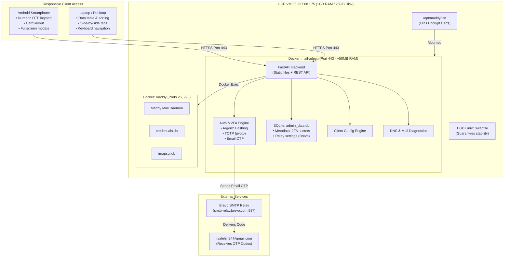

# Implementation Plan: Self-Hosted Mail Admin Dashboard (React + Material UI)

Build, secure, and deploy a self-hosted **Mail Admin Dashboard** for `rsalehin24.me` on the existing GCP mail server (`35.237.68.175`, accessible via [mail.sh](file:///Users/rsalehin24/mail.sh)).

The system pairs a **FastAPI backend** with a **minimalist, high-aesthetic React + Material UI (MUI)** frontend compiled to static assets. It is purpose-built and fully responsive across **Android phones, laptops, and desktops**, ensuring seamless management from any device while consuming only ~50 MB of RAM on the 1 GB server.

---

## User Review Required

> [!IMPORTANT]
> **Admin Email & Authentication**: Strictly locked to `rsalehin24@gmail.com`. On initial launch, a setup wizard prompts you to set your Master Password and scan a TOTP QR code into Google Authenticator or Apple Passwords.

> [!NOTE]
> **Identified Gaps & Proposed Solutions**:
> 1. **TLS Renewal Sync**: When `/opt/maddy/renew-cert.sh` renews certificates, it restarts `maddy` but not `mail-admin`. We will update the renewal script to also restart `mail-admin` so HTTPS certificates never expire.
> 2. **Build Memory Safety (1 GB RAM)**: Running `npm run build` on a 1 GB VM can cause Out-Of-Memory (OOM) errors. We will enable a 1 GB swapfile first and optimize the build to stay strictly within memory bounds.
> 3. **2FA Chicken-and-Egg**: Email OTP requires active Brevo credentials. The initial setup wizard will bootstrap TOTP (Authenticator App) first with backup recovery codes; Email OTP activates as soon as Brevo credentials are confirmed.
> 4. **Existing Account Discovery**: On first launch, the app will automatically ingest existing Maddy accounts (`reyan@`, `mail@`, `cloud@`, `salehin@`, etc.) so no existing mailboxes are missed.
> 5. **DNS & Mail Health Indicator**: The dashboard will include a live diagnostic widget showing MX resolution, A record, and port status to make troubleshooting effortless.

---

## Architecture & Resource Footprint



### Resource Breakdown
* **Server RAM Consumption**: ~45–60 MB (Server currently has 553 MB free).
* **Disk Space Consumption**: ~200 MB total (Server has 23 GB free).
* **System Hardening**: Enable a 1 GB swapfile on the VM to ensure smooth operation during background tasks.

---

## Detailed Gap Analysis & Solutions

| # | Potential Gap | Root Cause | Built-in Solution |
| :--- | :--- | :--- | :--- |
| **1** | **Let's Encrypt Cert Expiry** | `/opt/maddy/renew-cert.sh` only restarts Maddy | Update `renew-cert.sh` to run `docker restart mail-admin` upon renewal. |
| **2** | **OOM During Frontend Build** | Node.js Vite build can exceed 1 GB RAM | Build optimized static bundle locally or use 1 GB swap + Node memory limits (`--max-old-space-size=512`). |
| **3** | **2FA Lockout / Chicken-and-Egg** | Email OTP cannot send before Brevo credentials are saved | Setup wizard bootstraps TOTP App first + provides 5 backup recovery codes. Email OTP enables once Brevo is saved. |
| **4** | **Existing Accounts Missing** | New `admin_data.db` is initially empty | Backend runs auto-discovery on startup: calls `maddy creds list` and imports existing mailboxes automatically. |
| **5** | **Confusion Over Dual Passwords** | IMAP uses Maddy password; SMTP uses Brevo master key | The Client Config modal clearly delineates **Incoming Password** (account pass) vs **Outgoing Password** (Brevo key). |
| **6** | **Inbound Email Not Flowing** | Cloudflare MX still points to Cloudflare Email Routing | Live DNS Health Widget in Dashboard checks and warns if MX does not point to `mail.rsalehin24.me`. |

---

## Proposed Changes

All application files will reside in `/opt/mail-admin/` on the server and run via Docker Compose.

### Component 1: React + Material UI Frontend (Multi-Device Optimized)

Built with Vite, Material UI (`@mui/material`, `@mui/icons-material`, `@emotion/react`), and responsive breakpoint hooks (`useMediaQuery`).

#### Responsive Design Breakdown:
| Feature | Android Phone (`< 600px`) | Laptop & Desktop (`≥ 960px`) |
| :--- | :--- | :--- |
| **Mailbox List** | Touch-friendly card view with expand/collapse details | Full data table with sorting, search, and pagination |
| **2FA Code Input** | Auto-focuses native numeric pad (`inputMode="numeric"`) | Standard keyboard navigation with auto-advance |
| **Modals / Dialogs** | Fullscreen mobile dialogs for effortless reading | Centered elevation cards with side-by-side tabs |
| **Copy Actions** | Large touch targets with bottom snackbar confirmation | Compact copy buttons with floating hover tooltips |
| **Navigation** | Sticky mobile header with drawer menu | Desktop top app bar with direct tab switching |

#### [NEW] `/opt/mail-admin/frontend/src/`
- **`theme.ts`**:
  - Responsive typography scaling (fluid header sizes on mobile vs desktop).
  - Minimalist palette (slate dark/light modes, crisp contrast, Inter font).
  - Minimum 48px touch targets on mobile viewports.
- **`views/LoginView.tsx`**:
  - Step 1: Admin email (`rsalehin24@gmail.com`) and password.
  - Step 2: 6-box auto-advancing 2FA input. Configured with `inputMode="numeric"` and `autoComplete="one-time-code"` so Android keyboards display number pads and offer 1-tap OTP autofill.
  - Backup option: "Send 6-digit code to rsalehin24@gmail.com" with a countdown timer.
  - Emergency fallback: "Use Recovery Code" option.
- **`views/SetupView.tsx`**:
  - One-time initial setup wizard displaying the TOTP QR code, secret key, and 5 one-time recovery codes.
- **`views/DashboardView.tsx`**:
  - Live Diagnostic Bar: Status pills for **Server Health**, **Brevo Relay**, and **DNS MX Record**.
  - Dynamic display: Renders responsive **Cards** on Android/mobile, and a **Data Table** on laptop/desktop.
  - Search bar and filtering.
  - Quick action buttons: **Configure**, **Reset Password**, **Delete**.
- **`components/NewMailboxDialog.tsx`**:
  - Modal to create a new `@rsalehin24.me` address.
  - Fields: Username prefix, Display Name, Notes/Purpose.
  - One-click strong password generator with clipboard copy.
- **`components/ClientConfigDialog.tsx`**:
  - Dedicated configuration modal for every mailbox. Fullscreen on phone, elegant centered dialog on desktop.
  - Tabbed views:
    - 🍏 **Apple Mail (macOS & iOS)**
    - 📱 **Google Gmail (Android / iOS / Web "Send As")**
    - 💻 **Mozilla Thunderbird / Microsoft Outlook**
    - ☁️ **Nextcloud Mail**
    - ⚙️ **Raw Connection Details**
  - Explicit separation:
    - **Incoming (IMAP)**: `mail.rsalehin24.me` | Port 993 | SSL | Username | Account Password.
    - **Outgoing (SMTP)**: `smtp-relay.brevo.com` | Port 587 | STARTTLS | Brevo Login | Brevo Key.
  - Instant one-click copy buttons for every field.
- **`views/SettingsView.tsx`**:
  - **Brevo & Relay Settings**:
    - SMTP Host, Port (587/465), SMTP Username, SMTP Password / Key.
    - Optional Brevo REST API Key (to display daily quota: e.g. *280/300 remaining*).
    - **"Test Connection" button**: Sends a test ping to verify credentials before saving.
  - **Security Settings**:
    - Change Master Password.
    - View/Regenerate 2FA Backup Recovery Codes.

---

### Component 2: Backend API & Maddy Manager (FastAPI)

#### [NEW] `/opt/mail-admin/backend/main.py`
FastAPI backend that serves static production assets from the compiled React build (`dist/`) and exposes secure REST endpoints:
- `GET /api/status`: Health check, DNS MX verification, and Maddy status.
- `POST /api/setup`: Initial admin password, recovery codes, and 2FA activation.
- `POST /api/login`: Step 1 credential check.
- `POST /api/2fa/verify`: Step 2 TOTP or Email OTP validation.
- `POST /api/2fa/send-otp`: Dispatches 6-digit code to `rsalehin24@gmail.com` via Brevo.
- `GET /api/accounts`: Returns all mailboxes with metadata (auto-discovers existing Maddy accounts).
- `POST /api/accounts/create`: Provisions Maddy credentials + IMAP mailbox + metadata.
- `POST /api/accounts/{email}/password`: Updates Maddy password.
- `DELETE /api/accounts/{email}`: Deletes Maddy credentials and IMAP mailbox.
- `GET /api/accounts/{email}/config`: Returns formatted client configuration templates.
- `GET /api/settings/relay`: Retrieves current relay configuration.
- `POST /api/settings/relay`: Updates relay configuration with optional test ping.

#### [NEW] `/opt/mail-admin/backend/auth.py`
- Argon2 / Bcrypt password hashing via `passlib`.
- TOTP secret generation, provisioning URI (`otpauth://`), and verification via `pyotp`.
- Base64 QR code generation for camera scanning via `qrcode`.
- Rate limiting middleware (prevents brute-force on passwords and OTP codes).
- Encrypted HTTP-only, SameSite=Strict session cookies.

#### [NEW] `/opt/mail-admin/backend/maddy_service.py`
Executes Maddy CLI commands via Docker socket:
- `maddy creds create <email>`
- `maddy imap-acct create <email>`
- `maddy creds password <email>`
- `maddy creds remove <email>`
- `maddy imap-acct remove <email>`
- `maddy creds list` (synchronizes existing accounts on first start).

#### [NEW] `/opt/mail-admin/backend/database.py` & `models.py`
SQLite database (`admin_data.db`):
- `admin_auth`: Admin password hash, TOTP secret, recovery codes, initialized flag.
- `relay_settings`: Brevo SMTP host, port, username, encrypted password, API key.
- `mailboxes`: Email, display name, notes, created_at, updated_at.
- `otp_codes`: Pending 6-digit email OTP codes with 5-minute expiration.
- `audit_logs`: Timestamped activity logs (logins, account creations, password changes).

---

### Component 3: Deployment & Host Tuning

#### [NEW] `/opt/mail-admin/Dockerfile`
Multi-stage Dockerfile:
1. **Stage 1 (Frontend Build)**: Node.js 20-alpine runs `npm run build` using Vite to compile React + MUI into optimized static files.
2. **Stage 2 (Runtime)**: Python 3.11-slim packages FastAPI, Uvicorn, and Docker CLI. Serves the static build and REST API over HTTPS on port 443 with existing TLS certificates.

#### [NEW] `/opt/mail-admin/docker-compose.yml`
```yaml
services:
  mail-admin:
    build: .
    container_name: mail-admin
    restart: unless-stopped
    ports:
      - "443:443"
    volumes:
      - ./data:/app/data
      - /opt/maddy/tls:/tls:ro
      - /var/run/docker.sock:/var/run/docker.sock:ro
    environment:
      - ADMIN_EMAIL=rsalehin24@gmail.com
      - PRIMARY_DOMAIN=rsalehin24.me
      - MAIL_HOST=mail.rsalehin24.me
```

#### [MODIFY] `/opt/maddy/renew-cert.sh`
Update line 33 of `/opt/maddy/renew-cert.sh` to restart both containers on cert renewal:
```bash
docker restart maddy mail-admin
```

#### [MODIFY] Host Swap Configuration
Create a 1 GB swapfile on the host to ensure the 1 GB VM is protected against memory spikes:
```bash
sudo fallocate -l 1G /swapfile && sudo chmod 600 /swapfile && sudo mkswap /swapfile && sudo swapon /swapfile
```

---

## Verification Plan

### Automated Verification
Run from the local Mac terminal:
1. **Check Service Port & Health**:
   ```bash
   curl -vk https://35.237.68.175/api/status
   # Expected: HTTP 200 with JSON status "ok"
   ```
2. **Verify TLS Certificate**:
   ```bash
   openssl s_client -connect mail.rsalehin24.me:443 -servername mail.rsalehin24.me </dev/null 2>/dev/null | grep -E "CN|subject|issuer"
   # Expected: CN = mail.rsalehin24.me, Let's Encrypt
   ```
3. **Verify Container Resource Usage**:
   ```bash
   ssh deployer@35.237.68.175 "sudo docker stats --no-stream mail-admin"
   # Expected: Memory usage <= 60 MB, CPU idle < 1%
   ```

### Manual Verification Flow
1. **Multi-Device Responsive Test**:
   * **Android Phone**: Open `https://mail.rsalehin24.me` in Chrome on Android. Verify the numeric pad pops up automatically for the 2FA code, touch targets are comfortable, and accounts display as cards.
   * **Laptop / Desktop**: Open in desktop browser. Verify the full data table, keyboard shortcuts, and side-by-side configuration tabs.
2. **Initial Setup**:
   * Scan the QR code into Google Authenticator or Apple Passwords on your phone. Save the 5 recovery codes.
   * Verify the 6-digit code.
3. **2FA Login**:
   * Log out and log back in using your Master Password + TOTP code.
   * Test the "Send OTP to Email" backup option and confirm code arrives at `rsalehin24@gmail.com`.
4. **Brevo Settings & Test Connection**:
   * Navigate to the **Settings** tab.
   * Verify Brevo SMTP settings. Click **"Test Connection"** to verify outbound relay.
5. **Mailbox Management**:
   * Verify existing accounts (`reyan@`, `mail@`, etc.) were automatically discovered.
   * Create a test account (e.g. `test_admin@rsalehin24.me`) with a generated password and note.
   * Open the **"Configure"** dialog; check the tabs for **Gmail**, **Apple Mail**, and **Nextcloud**. Test copy buttons.
   * Delete the test account and verify it is removed from Maddy.
